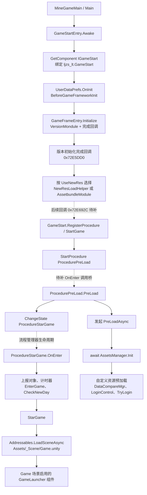
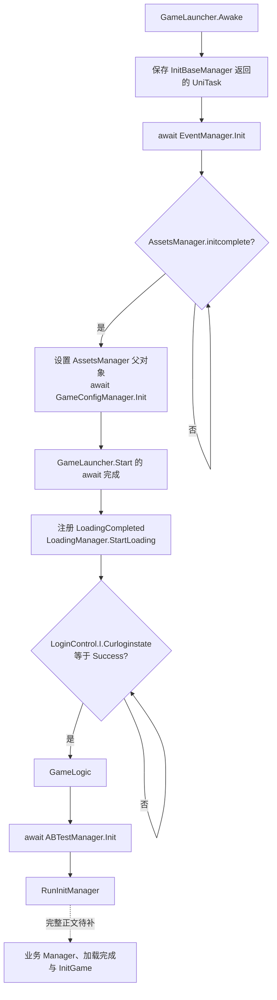
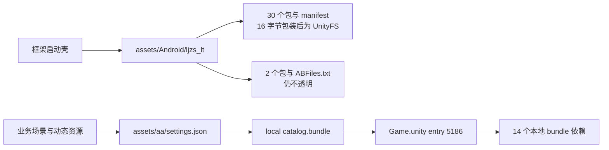

# 08｜启动链与平台适配

本章面向希望学习恢复过程的 Unity 开发者，说明我们如何从场景、IL2CPP 元数据、原生方法和资源目录中还原“游戏是怎样启动的”。同时给出可重复的查询方法和后续实现边界。

本文结论适用于当前分析的《占城大师》APK：SHA-256 为 `4544b6323c6a2b11dd801fb75d99dbe6fc59253443bde5a24738d772694b0a2d`。Unity 包内版本是 `2022.3.62f3`，Addressables 设置记录版本 `1.22.3`。APK 文件名的 `1.04` 与 Unity PlayerSettings 的 `bundleVersion=2.17.1` 属于不同来源，不能互相替换。

**当前已把首场景、流程对象、Game 场景以及 GameLauncher 的主要前置条件接到一起。这里仍是静态恢复证据，尚不代表完整启动代码已经还原，或已经在 Unity Editor 运行通过。** `GameLauncher.InitManager` 当前只完成汇编正文导出；它的完整伪 C 尚未生成。

## 1. 先区分四类证据

恢复过程中，一个常见错误是把“找到名字”当成“找到了实现”。我们对每项结论标明证据层级。

| 层级 | 本次材料 | 能证明什么 | 不能单独证明什么 |
|---|---|---|---|
| 场景与配置 | APK 序列化对象、导出 YAML、Addressables catalog | 组件身份、启用状态、字段值、资源地址与目录依赖 | 组件方法已恢复、资源能在 Windows Editor 正确执行 |
| 元数据 | `dump.cs`、`DummyDll`、`script.json` | 类型、程序集、字段偏移、方法签名、RVA、泛型实参、字符串 | 方法内部调用顺序与分支 |
| 原生正文 | IDA 汇编、伪 C | 调用、字段读写、条件与等待关系 | 自动得到正确 C#；所有间接调用都已解析 |
| 运行证据 | Editor PlayMode、运行日志、画面和交互 | 这一轮实际执行到哪里、是否有错误、交互是否生效 | 没有检查的其他流程或平台也正确 |

本章前 3 类已有材料。运行层的验收必须由后续工程恢复另行记录。AssetRipper 输出的业务 `.cs` 当前来源于 DummyDll；空方法可以帮助恢复序列化布局，却不能执行原游戏逻辑。

## 2. 从首场景确认真正的入口

APK 的 BuildSettings 仅列出：

```text
Assets/GameRes/BundleRes/Scene/MineGameMain.unity
```

在 `data.unity3d/level0` 中，名为 `Main` 的 GameObject（PathID 5）挂接以下组件：

| 组件 | 序列化 PathID | 程序集 | 角色的证据范围 |
|---|---:|---|---|
| `GameFramework.Base.GameStartEntry` | 144 | `GFRunning.dll` | 正文证明其取得 `IGameStart` 并启动框架初始化 |
| `ljzs_lt.GameStart` | 145 | `Assembly-CSharp` | 类型继承 `IGameStart`，正文证明其注册并启动流程 |
| `CommonGameModule.Login.LoginTest` | 146 | `Assembly-CSharp` | 测试登录字段与 Awake 存在；不能据此假定实际走测试登录 |
| `L_Tools.ServerMgr` | 147 | `Assembly-CSharp` | 平台字段实值为 Android 枚举 |

`GameStartEntry` 的原始对象共 76 字节。我们先按 Unity 字符串长度、4 字节对齐和可序列化字段顺序恢复值，再与 AssetRipper 导出的 YAML 核对。

| 字段 | 实值 | 原始对象内位置 | 导出场景核对 |
|---|---|---:|---|
| `isShowInitGameLog` | `true` | 32 | 1 |
| `AppName` | `ljzs_lt` | 长度在 36，正文在 40 | 相同 |
| `gameCode` | `U-CSZDZ` | 长度在 48，正文在 52 | 相同 |
| `langLibrary` | 1 | 60 | 相同 |
| `appDefaultLangType` | 0 | 64 | 相同 |
| `m_Fastmode` | `false` | 68 | 0 |
| `m_AutoSaveData` | `false` | 72 | 0 |

这些位置是**序列化对象内的字节位置**，与 `dump.cs` 的 IL2CPP 运行时实例字段偏移不是同一口径。例如 `AppName` 的运行时字段偏移是 `0x28`，并不表示序列化对象的第 40 字节保存一个运行时对象指针。

`m_Fastmode` 的元数据说明为“开启此模式后，数据类和逻辑类不再自动初始化”。本包场景值为 false，因此恢复时应保留完整初始化。把它打开可能让启动路径变短，却会改变原有的数据和逻辑契约。

`ServerMgr.platform` 为 1005，对应 `L_Tools.PlatformEnum.APP_Android`。当前也能看到 `APP_NoServer=-99` 的枚举声明，但没有证据证明单独选它就能得到完整的本地可玩流程。

证据文件：

- [导出的首场景](C:/Users/luxinyu/Documents/Codex/2026-10-19/x20/outputs/OccupyCityRecovered/Assets/gameres/bundleres/Scene/MineGameMain.unity:2658)
- 原始对象与摘要：`work/startup-restore/level0-144.bytes`、`serialized-candidates.json`。
- 可复查脚本：`work/startup-restore/inspect_serialized.py`。

## 3. 首场景如何转到 Game 场景

以下流程图使用实线表示已有正文或绑定证据的关系，虚线表示还需要补齐的框架生命周期桥。并行分支表示代码发起了异步工作，不能理解成一条全部同步完成的直线。



这里有一个重要的异步关系：`ProcedurePreLoad.PreLoad` 发起 `PreLoadAsync()` 后，马上切换到 `ProcedureStarGame`。`PreLoadAsync` 是 `async void`，不是 `await` 返回的 UniTask。因此 Game 场景加载与前置资源、登录工作存在时间重叠。业务入口中的等待条件正是连接这些工作的关键。

已经核实的主要方法如下。地址均为本次 arm64 `libil2cpp.so` 的 RVA；它们不是其他 APK 或其他 ABI 可以直接复用的地址。

| 方法 | RVA | 正文确认的行为 |
|---|---|---|
| `GameStartEntry.Awake()` | `0x72E86A4` | 取得 `IGameStart`，设置双向引用，设置文化、保存数据入口、DontDestroyOnLoad，调用框架初始化 |
| `GameStart.RegisterProcedure()` | `0x439B9F4` | 注册 `ProcedurePreLoad`、`ProcedureStarGame`、`ProcedureExitGame` |
| `GameStart.StartGame()` | `0x439C028` | `StartProcedure<ProcedurePreLoad>()` |
| `ProcedurePreLoad.PreLoad()` | `0x439F890` | 发起 `PreLoadAsync`，随后 `ChangeState<ProcedureStarGame>()` |
| `ProcedurePreLoad.<PreLoadAsync>d__4.MoveNext()` | `0x43A01BC` | 初始化设置、资源、登录对象；完整步骤见下一节 |
| `ProcedureStarGame.OnEnter(...)` | `0x43A07CC` | 注册退出事件、计时和上报、置 EnterGame、检查新日期，进入 StarGame |
| `ProcedureStarGame.StarGame()` | `0x43A09D4` | 加载 `Assets/_Scene/Game.unity` |

最后一个调用同时由字符串映射和寄存器取值确认：

```csharp
// 对已观察调用的等价描述，不是从 APK 导出的原始 C#。
Addressables.LoadSceneAsync(
    "Assets/_Scene/Game.unity",
    LoadSceneMode.Single,
    activateOnLoad: true,
    priority: 100);
```

在 `0x43A0A70` 附近的汇编中，X0 来自字符串引用 `0x8D581F0`，W1=0、W2=1、W3=100。它与 dump 中方法签名共同约束了实参。伪 C 把结构体返回缓冲区写成额外第一个参数时，不能照抄回 C#。

## 4. GameLauncher 是怎样被创建的

我们最初检查是否存在“配置字符串选择子游戏入口”的机制。`stringliteral.json` 中确实有 `CoreModule.GameLauncher`，但字符串存在本身不能说明它被反射调用。

随后在导出的 Game 场景找到直接绑定：

```yaml
# Game.unity，摘录并省略无关字段。
--- !u!1 &6
GameObject:
  m_Component:
  - component: {fileID: 35}
  - component: {fileID: 95}
  - component: {fileID: 96}
  m_Name: GameLauncher
  m_IsActive: 1

--- !u!114 &95
MonoBehaviour:
  m_GameObject: {fileID: 6}
  m_Enabled: 1
  m_Script:
    {fileID: 11500000, guid: c353f56bf56302c788552a008cab3e31, type: 3}
```

该 GUID 与 `Assets/Scripts/Assembly-CSharp/CoreModule/GameLauncher.cs.meta` 一致。因此当前入口的证据是：**Game 场景包含启用的 GameLauncher 组件，Unity 场景生命周期会接管它的 Awake/Start。** 至今没有把任何已读配置认定为反射入口配置。

两个看起来相关但用途不同的配置也已核对：

- `Resources/jsondata/GameSettingConfig` 解码后是 10 条胜负分、经验、赛季次数等玩法数值，不含入口类型。
- `assets/GameDefaultConfig.txt` 只包含 `GameDefaultLanguage=zh`。

证据：[Game 场景的 GameLauncher 对象](C:/Users/luxinyu/Documents/Codex/2026-10-19/x20/outputs/OccupyCityRecovered/Assets/_Scene/Game.unity:183)、[GameLauncher 脚本元文件](C:/Users/luxinyu/Documents/Codex/2026-10-19/x20/outputs/OccupyCityRecovered/Assets/Scripts/Assembly-CSharp/CoreModule/GameLauncher.cs.meta)。导出的 `.cs` 方法仍是 DummyDll 空实现，场景绑定恢复与方法恢复是两个步骤。

## 5. 两个已经核实的 WaitUntil 条件



| 等待位置 | 条件方法 RVA | 实际字段 | 证据如何对应 |
|---|---|---|---|
| `InitBaseManager` | `0x419234C` | `AssetsManager.initcomplete`，实例偏移 `0x4D`，bool | 原生方法取得 AssetsManager 后读取 `Instance + 77`；77 即十六进制 0x4D，与 dump 字段一致 |
| `Login` | `0x419239C` | `LoginControl.I.Curloginstate`，实例偏移 `0x74`，枚举 | TypeInfo 为 LoginControl，读取静态 I 后比较实例偏移 116 的 int 是否等于 1；116=0x74，`LoginState.Success=1` |

前一个等待的生产者是 `ProcedurePreLoad` 发起的 `AssetsManager.Init()`。随后补到的 `0x3F13BE4` 正文证明：它先 await `GenerateGroupsMap()`，把 `BundleLoadingProgress` 设为 1，再调用 `ObjPoolManager.Init()`，发出 `AssetsManagerInitComplete` 事件，最后才把 `initcomplete` 设为 true。这里没有观察到对 ObjPoolManager.Init 返回任务的等待，也没有直接出现 Addressables.InitializeAsync。因此，这个 bool 不能扩大解释成“全部 bundle 和整个资源系统已经加载完”。事件回调发生在 bool 写为 true 之前，恢复时应保持这个顺序。

另外两个业务初始化等待也已取得短方法正文：`0x41923F8` 读取 `CustomBundlesManager._preloadTaskCompleted`（0x28）；`0x4192418` 读取 `DataManager.LoadDataCompleted` 的 backing field（0x20）。它们分别关联自定义资源预加载和用户数据加载，不应合并成一个无条件的“Ready”。

登录成功路径也补到了两段：`LoginSuccess`（0x43B7518）写入 Success 并调用 `OnFinishLogin(true)`；`OnFinishLogin`（0x43B75FC）清除 `NeedCheckSyncOutTime`，设置 Success/Fail，在 `!ForceLogin || success` 条件下将 `LTPlayerPrefsDataManager.CanSave=true`，调用其 `Load()` 并发送 `InitAfterLogin` 消息，最后调用并清空 `loginCallBack`。这说明直接修改枚举会漏掉存档和事件步骤；更早阶段如何建立 LoginUseInfo、LTPlayerPrefsDataManager 等对象，仍需要继续追踪。

`PreLoadAsync` 已证实的步骤是：

1. 调用 `InitGameSetting()`。
2. 取得 AssetsManager，保留其 GameObject，等待其 `Init()`。
3. 发起 `CustomBundlesManager.Preload().Forget()`。
4. 创建名为 `DataCompareMgr` 的 GameObject 并挂上同名组件。
5. `new LoginControl(OnLoginValid)`，保存到异步闭包。
6. 读取 `DBTSDK.AppInfoManager.GetAppChannelGroup()`；若转小写后包含 `huawei`，将登录基类的 `IsDefaultTouristLogin`（0x28）与 `UseLoginCache`（0x51）设为 false。
7. 调用闭包中的 `TryLogin`。其后续数据成功契约仍待展开。

这种顺序说明：登录对象的存在、登录数据的准备和 Success 状态之间有原有契约。只把最后的状态条件设为 true，可能让后续存档或用户资源逻辑访问未初始化对象。

## 6. 如何把 qword 映射回类型、泛型与字符串

这是本次研究最实用的取证步骤。IDA 可能显示：

```c
Module_object = GameFramework_GameFrameEntry__GetModule_object_(qword_8D2D170);
GameFramework_Procedure_ProcedureManager__StartProcedure_object_(
    Module_object, qword_8D36008);
```

如果只看 `object`，容易误以为类型已经丢失。IL2CPP 的泛型共享实现会使用额外的 MethodInfo 参照；这些参照在 `script.json` 中常保留具体泛型实例。

本次查询结果为：

| 地址 | script.json 分类 | 解析结果 |
|---|---|---|
| `0x8D2D170` | `ScriptMetadataMethod` | `GameFrameEntry.GetModule<ProcedureManager>()` |
| `0x8D36008` | `ScriptMetadataMethod` | `ProcedureManager.StartProcedure<ProcedurePreLoad>()` |
| `0x8D12008` | `ScriptMetadataMethod` | `ManagerBase<AssetsManager>.get_Instance()` |
| `0x8D12148` | `ScriptMetadataMethod` | `ManagerBase<EventManager>.get_Instance()` |
| `0x8D121A0` | `ScriptMetadataMethod` | `ManagerBase<GameConfigManager>.get_Instance()` |
| `0x8D17890` | `ScriptMetadataMethod` | `QuickTutor.Singleton<ABTestManager>.get_Instance()` |
| `0x8CEA1F0` | `ScriptMetadata` | `L_Tools.LoginControl_TypeInfo` |
| `0x8D581F0` | `ScriptString` | `Assets/_Scene/Game.unity` |

因此，这段代码可以被解释为“取得 ProcedureManager 并启动 ProcedurePreLoad”。解释建立在元数据实参和调用正文共同存在的基础上。

可以用下面的只读 Python 查询单个地址。将 `root` 替换为这次工作的根目录即可；整个 JSON 较大，适合一次载入后批量查地址。

```python
import json
from pathlib import Path

root = Path(r"C:\Users\luxinyu\Documents\Codex\2026-10-19\x20")
script = json.loads(
    (root / "outputs/IDA分析材料/Il2Cpp导出/script.json")
    .read_text(encoding="utf-8-sig")
)
addresses = {0x8D2D170, 0x8D36008, 0x8D581F0}

for category in ("ScriptMetadata", "ScriptMetadataMethod", "ScriptString"):
    for row in script.get(category, []):
        if row.get("Address") in addresses:
            print(category, hex(row["Address"]), row)
```

本次已经实现批量版本 `work/startup-restore/resolve_refs.py`。它从现有 `.c` 和 `.asm.txt` 提取 `qword_`、`off_`、`unk_` 后的地址，查 `script.json`，结果保存为 `native-refs.json`。随后 `summarize_asm.py` 将解析结果标注到关注的汇编引用旁。

使用时需要注意三个区别：

- 地址匹配到元数据参照槽，不等于该地址就是函数代码。`ScriptMetadataMethod.MethodAddress=0` 也不表示这个方法不能执行，常见原因是泛型共享实现。
- 伪 C 中 `ManagerBase<object>` 可能代表共享代码；具体类型需要根据当前调用的 MethodInfo 判断。
- `MoveNext` 的文本顺序不一定是运行顺序。状态机会先根据 `<>1__state` 跳转到不同恢复点，必须结合 awaiter 的保存、取回与跳转还原。

目前本次 IDA 数据库 image base 为 0，dump 的 RVA 与 VA 一致；文件 Offset 通常为 RVA-0x4000。查询时仍以 `dump.cs` 与该 ELF 的段映射为准，不把这个差值当成通用规律。

## 7. 资源 provider 与两套资源链

包内至少有两套可识别的资源布局，必须分别恢复。



Addressables 的读取证据如下：

| 层 | 已读出的配置 |
|---|---|
| 初始化设置 | buildTarget=Android；catalog 在 `{Addressables.RuntimePath}/catalog.bundle` |
| catalog locator | `AddressablesMainContentCatalog` |
| 场景 provider 配置 | `UnityEngine.ResourceManagement.ResourceProviders.SceneProvider` |
| 实例 provider 配置 | `UnityEngine.ResourceManagement.ResourceProviders.InstanceProvider` |
| bundle provider | `UnityEngine.ResourceManagement.ResourceProviders.AssetBundleProvider` |
| bundle 内资产 provider | `UnityEngine.ResourceManagement.ResourceProviders.BundledAssetProvider` |
| Game 场景目录条目 | internal ID 与 primary key 均为 `Assets/_Scene/Game.unity`；resourceType 为 `SceneInstance` |
| Game 场景条目的 provider 字段 | `BundledAssetProvider`，不能据此把实际 LoadSceneAsync 改成 LoadAssetAsync |
| 编辑侧地址配置 | `AddressablesConfig` 将 Game 场景归入 `Default Local Group` |

`SceneProvider` 是 catalog 的专门场景 provider 配置，而某个资源条目中的 provider ID 是另一个字段。应分别记录，并沿原 `Addressables.LoadSceneAsync` 调用恢复，不能混为一谈。

我们解码了 catalog 的 base64 索引段：bucket data、key data、entry data。每个 entry 有 7 个 int32：internal ID 索引、provider 索引、依赖 bucket、依赖 hash、附加数据索引、primary key 索引、资源类型索引。通过长度、边界和引用索引检查后，得到 Game 场景为 entry 5186、依赖 bucket 7761，闭包包含 14 个 bundle；全部在 APK 内存在。

结果位于 `work/startup-restore/catalog-scene-closure.json`，脚本为 `catalog_scene.py`。它只证明目录里的场景依赖；游戏在运行时按字符串动态加载 UI、单位、配置时，还会增加其他资源。

旧框架资源第一次直接交给 UnityPy 时返回零对象，没有抛出异常。这个结果只表示没有读出对象。资源恢复分支随后定位到其中 31 个文件的 UnityFS signature 位于偏移 16，我们在副本上移除包装后独立复核成功。另两包与 `ABFiles.txt` 尚未解码。这个过程说明，“工具没有报错”和“得到有效解析结果”需要分开记录。

### 7.1 导出路径不一定还是原地址

进一步把 catalog 中 3,681 个唯一 `Assets/` internal ID 与当前导出工程逐项比较，得到：

| 路径比对结果 | 数量 | 解释 |
|---|---:|---|
| 精确同名文件存在 | 3,295 | 只确认路径；类型、引用和内容仍需检查 |
| 仅大小写不同 | 1 | 地址是字符串，不能把 Windows 文件系统容忍大小写当作所有平台都安全 |
| 原路径无同名文件 | 385 | 需要导出物映射；不是直接判定 385 个资源丢失 |

385 项主要包括 186 个 FBX、87 个 `.mesh`、100 个音频、3 个 shadergraph、5 个 PSD，以及少量其他资产。AssetRipper 常把一个 FBX 的结果拆成 `.prefab`、`.anim`、`.asset` 等文件，因此原来的一个路径可能对应多个请求类型。

例如 `HealingTotem.fbx` 在 catalog 中对应 GameObject 和 Mesh 两类资源，导出目录中出现 `HealingTotem.prefab` 与 `HealingTotem.asset`。它们是候选关系，仍需用原对象身份、资源类型和导出引用核实。直接把 `.fbx` 后缀全替换成 `.prefab` 会破坏 Mesh、Avatar 或 AnimationClip 请求。

应建立的映射至少包含“原地址、请求类型、必要时的子资源身份、导出对象/GUID”。既要保留业务代码的原地址，也要让最终 provider 返回原请求需要的 Unity 类型。此路径审计记录在 `work/startup-restore/address-path-audit.json`，完整 catalog 条目在 `catalog-entries.json`；后缀替代项明确标为候选，尚未当成可用映射。

## 8. 平台适配如何保留原游戏逻辑

最小可运行方案应沿原启动流程恢复，先把外部能力收敛成 Editor 可提供的接口，再让原业务初始化消费这些结果。下面是实现方向，尚未作为已完成代码交付。

| 边界 | Editor 适配需要提供什么 | 应继续保留的原逻辑 |
|---|---|---|
| Android / DBTSDK 生命周期 | 本地环境资料、AppChannelGroup、可完成的初始化回调 | 框架初始化顺序与完成事件 |
| 上报 | 本地可记录的事件接收器 | 原来的事件时机、时间统计和业务流转 |
| 登录 | 合法的本地身份、LoginUseInfo、存档对象、成功或失败回调 | LoginControl 数据成功路径和状态变更；先取证再实现 |
| 网络时间 | 来源明确的本地时间服务、有效初始化完成信号 | DateTime 计算、跨日检查、保存逻辑 |
| AB 参数 / 远程配置 | 包内默认值或显式本地配置 | ABTestManager 的字段映射与 Init 完成语义 |
| IAP / 广告 | Editor 服务初始化状态；明确的模拟结果 | 购买、奖励和业务资源变化逻辑 |
| 资源 | 恢复的地址键、真实资产、有效异步句柄与失败结果 | AssetsManager、自定义预加载和资源生命周期 |
| 存档及业务管理器 | 恢复的可执行实现 | 数据、UI、相机、核心玩法、教程等原有初始化 |

资源侧建议用恢复出的资产为当前 Editor 平台重新建立 Addressables，而保留业务使用的原地址。不能假定 Android bundle 在 Windows Editor 中天然兼容。序列化引用、材质与 shader、字体和平台纹理仍需分别验证。

还要恢复库级初始化，例如 `UnityAsyncAwaitUtil.SyncContextUtil.Install`（RVA `0x711F2E4`）的 `RuntimeInitializeOnLoadMethod(BeforeSceneLoad)`，以及 UniTask、DOTS、Burst 自身的初始化。优先使用匹配版本的真实上游库，其同步上下文和 PlayerLoop 支持不能保留为 DummyDll 空方法。

`InitManager` 的汇编已确认涉及：TimeManager、DataManager.LoadConfig/Init/LoadData、HWIAPManager、UIManager、UserResourcesManager、CameraManager、CustomBundlesManager、PlayerCoreData 与 PlayerGuideData。它还包含 `WhenAll`、NoInternetPanel 预取、后台 Manager 启动以及日期写入和保存。目前只据汇编确认这些操作存在；完整分支与等待时序尚待补齐。

## 9. 当前未知边界与下一批方法

尚未证明或恢复的内容包括：

- `GameStartEntry` 初始化完成回调到各框架模块、`GameStart.StartGame` 之间的完整链。
- 流程管理器生命周期调度的全部内部实现，以及 `ProcedurePreLoad.OnEnter` 的短桥。
- `AssetsManager.Init` 的失败路径、catalog 初始化与 `initcomplete` 写入时机。
- `LoginControl` 登录成功时全部身份、存档及用户数据写入。
- `InitManager` 的完整 C# 等价实现；当前只有汇编正文。
- LoadingCompleted 的发送条件、订阅解除和 InitGame 的最终游戏入口。
- 旧框架两个不透明包是否包含启动必需内容。
- 导出的资产、shader、包版本、代码在 Editor 的真正兼容性和可玩性。

下一批应优先取小而关键的函数，避免被一个长方法的全量自动分析阻塞。下表更新了当前证据状态。

| 优先级 | 方法 | RVA | 要解决的问题 |
|---|---|---|---|
| 已补 | `GameStartEntry` 版本初始化完成回调（混淆名） | `0x72E5DD0` | 按 UseNewRes 选择新资源帮助器或 AssetbundleModule，再指向 0x72E692C |
| 已补 | `GameLauncher.<InitGame>d__14.MoveNext(): void` | `0x41932A4` | await GameManager.Init；GameManager 内部业务仍待恢复 |
| 1 | `LoadingManager.<LoadingScene>d__12.MoveNext(): bool` | `0x4083954` | 目前只有汇编；伪 C 长时间未返回，保留该限制 |
| 已补 | `GameLauncher.<RunInitManager>d__8.MoveNext(): void` | `0x41957D8` | 只等待 InitManager 完成，再结束 UniTaskVoid |
| 已补 | `GameLauncher.<>c.<InitManager>b__9_0(): bool` | `0x41923F8` | CustomBundlesManager._preloadTaskCompleted |
| 已补 | `GameLauncher.<>c.<InitManager>b__9_1(): bool` | `0x4192418` | DataManager.LoadDataCompleted |
| 已补 | `AssetsManager.<Init>d__15.MoveNext(): void` | `0x3F13BE4` | 分组映射、对象池调用、完成事件与 bool 的顺序 |
| 已补 | `LoginControl.LoginSuccess(): void` | `0x43B7518` | 写状态，调用 OnFinishLogin(true) |
| 已补 | `LoginControl.OnFinishLogin(bool): void` | `0x43B75FC` | 存档、InitAfterLogin 与回调契约 |
| 2 | `ProcedurePreLoad.OnEnter(...)` | `0x439F874` | 流程进入到 PreLoad 的短桥 |
| 3 | `GameLauncher.<InitManager>d__9.MoveNext(): void` | `0x41935B4` | 已有汇编，继续完整分支还原 |

新的必要后继是 `GameStartEntry` 的 `0x72E692C` 回调、`AssetsManager.<GenerateGroupsMap>d__18.MoveNext`（0x3F136BC），以及 GameManager.Init 的状态机。新一批结果在 `work/ida-startup-bounded/pseudocode`，其 runtime helper 原型已按经核实的 metadata 初始化、class init、noreturn 空引用异常修正；这减少了伪 C 的错误异常分支，但仍需结合汇编阅读。

后续运行验收至少应分别记录：首场景框架完成、Game 场景激活、资源 gate 成功、登录数据准备完成、必需 Manager 初始化完成、加载 UI 退出、真实游戏循环与输入反馈。每个阶段要有本轮运行证据；静态调用链中的实线不会自动变成运行验收通过。

## 10. 本章对应的工作材料

研究脚本读取 APK、现有导出或既有 IDA 结果，把研究文件写到 `work/startup-restore`。取得实现授权后，增加了独立 Editor 工具文件；它不修改业务运行代码，没有连接原游戏服务，也尚未由本分支启动 Unity。

| 文件 | 作用 |
|---|---|
| `work/recovery-ledger/startup-report.md` | 简洁的启动证据账本，供后续实现使用 |
| `work/startup-restore/startup-types.txt` | 启动相关类型、字段、RVA，带原 dump 行号 |
| `work/startup-restore/type-index.json` | 元数据类型定位索引 |
| `work/startup-restore/native-refs.json` | qword/off/unk 到类型、泛型方法、字符串的映射 |
| `work/startup-restore/resolve_refs.py` | 重新生成上述映射 |
| `work/startup-restore/catalog-scene-closure.json` | Game 场景 catalog 闭包与 APK 存在性 |
| `work/startup-restore/catalog_scene.py` | 重新解码 catalog 的只读脚本 |
| `work/startup-restore/address-path-audit.json` | 3,681 个原 internal ID 与导出路径的比对，不等于类型/内容验收 |
| `work/startup-restore/audit_address_mapping.py` | 重新生成路径审计，候选后缀不自动认定为等价 |
| `work/startup-restore/serialized-candidates.json` | 首场景字段原始字节与字符串线索 |
| `work/startup-restore/framework/inventory.json` | 旧框架包包装位置、对象与容器路径 |
| `work/ida-targeted/pseudocode/` | 主代理统一生成的 RVA 命名汇编与伪 C |
| `work/startup-restore/0x41935b4.asm.txt.summary.txt` | InitManager 汇编引用的注释摘要；不作为完整控制流 |

下一轮研究会继续补正文、对照字段和资源 consumer，检查官方 Fast Mode 对恢复资产的实际消费结果。以现有证据，已经能够说明原游戏怎样进入业务场景、为什么需要资源和登录等待，以及哪些初始化必须保留。

## 11. 已实现的真实 Addressables 设置准备工具

工具使用当前工程安装的官方 Addressables 1.22.3 API，创建 `AddressableAssetSettings`，选择官方 `BuildScriptFastMode`。它不安装假 provider。官方 FastModeInitializationOperation 会注册 SettingsLocator、AssetDatabaseProvider、SceneProvider 等真实服务；SceneProvider 的 Editor 非 bundle 分支使用 `EditorSceneManager.LoadSceneAsyncInPlayMode`。

实现文件：

- [BuildRecoveryAddressables.cs](C:/Users/luxinyu/Documents/Codex/2026-10-19/x20/outputs/OccupyCityRecovered/Assets/RecoveryTools/Editor/BuildRecoveryAddressables.cs)
- [独立 Editor asmdef](C:/Users/luxinyu/Documents/Codex/2026-10-19/x20/outputs/OccupyCityRecovered/Assets/RecoveryTools/Editor/OccupyCity.Recovery.Editor.asmdef)

映射计划为 `work/startup-restore/addressable-recovery-plan.json`。生成器读取了原 APK 的全部 19 个 Addressables bundle 容器；差异地址使用“容器地址 → serialized file/PathID → 原对象类型和名称 → 导出同目录下唯一同类型、同名称对象”的关系，保留源 bundle、PathID、类型、名称、导出 GUID。能在 `path_id_map.json` 中交叉确认的对象也单独标记，未把没有列在该简表中的 GameObject 判为不存在。

本轮计划包含 5,202 条 catalog 资产记录，首次生成时 5,082 条已映射、120 条 pending。随后加入原 GameObject 的 `Transform.m_Father==0` 根节点核对，区分同名根对象与子对象；读取 Shader 的 `m_ParsedForm.m_Name`；修正 YAML 单引号字符串中尾空格的解析。这些证据让 26 条待映射得到确认。

随后从 94 条待映射中继续核对 31 个只有单一原 Mesh 的地址。先沿已经确认的原模型根 Prefab 找到导出 `m_Mesh` 的 GUID，再比较原包与导出 Mesh 的几何数据：2 项顶点/索引原始字节完全一致；29 项使用压缩 Mesh，逐项比较顶点、三角形、法线和 UV 的 PackedBitVector 字节、元素数、位宽和量化起点/范围，全部得到唯一匹配。没有用“模型名字差不多”替代这些核对。

动画又采用另一条身份链：核对原包与导出的 44 个 AnimatorOverrideController 的名称和 `m_Clips` 数组长度，再按相同数组位置的 `m_OriginalClip` / `m_OverrideClip` 字段，把原 serialized file/PathID 对应到导出 clip GUID；最后检查导出对象类型和名称。这样新增确认了 7 个只有单一源动画的地址，0 个 controller 对应异常。并没有使用“时长相近”或任取同名动画的方法。

当前为 **5,146 条已有路径/来源映射证据，56 条 pending**。映射记录中，4,489 条保留原路径，619 条通过原 bundle 容器与导出对象核对差异，31 条增加了 Prefab 引用和精确 Mesh 几何证据，7 条增加了 override controller 指针对应；合计指向 3,952 个导出 GUID。剩余待映射为 Mesh 41、AnimationClip 15。所有已选目标文件存在，未发现同“地址 + 请求类型”指向多个 GUID 的计划冲突。**这组数字是映射计划的静态结果，不是 5,146 次 Unity 加载成功。**

几何核对脚本为 `work/startup-restore/prove_single_mesh_mappings.py`，证据保存在 `addressable-identity-overrides.json`。每项记录原 container/file/PathID、关联根Prefab、原始或压缩几何数据及导出文件SHA-256；主生成器只有在文件哈希仍匹配时才复用这份结果。这样重跑计划不会丢失核实工作，也不会把已被修改的导出文件默认为仍然相同。

动画指针对应脚本为`prove_animation_clip_refs.py`，明细为`clip-reference-proofs.json`；确认结果也存入同一份带哈希的identity overrides，供主计划生成器复用。

剩余问题中有一类不能靠改文件名解决：一个原 FBX 容器地址可能同时指向多个 Mesh 或多个 AnimationClip，而 catalog 只给出同一个路径与类型。比如 Bear Idle.FBX 中包含 9 段动画。即使每段动画都已导出，也不能任选一段作为该裸地址的默认结果。需要继续查其子资源名、调用方请求形式和原 provider 的选择语义；此时保持 pending 比伪造“唯一映射”更准确。

官方 SettingsLocator 用 `Dictionary<object, HashSet<AddressableAssetEntry>>` 存储地址到 entry 的关系，再按 requested Type 选择。因此，原 FBX 地址对应 Prefab、Mesh、AnimationClip 时，可以保留相同原地址并创建多个真实 entry。同一 GUID 需要保留多个原地址时，工具用额外地址标签作为别名；工具执行后会再次通过官方 locator 检查唯一性，不能仅靠“添加 entry 没抛异常”确认成功。

工具提供两个入口：

```text
OccupyCity.Recovery.Editor.BuildRecoveryAddressables.ValidateOnly
OccupyCity.Recovery.Editor.BuildRecoveryAddressables.Build
```

也可通过 Unity 菜单 `Tools > Occupy City Recovery` 使用。默认从本次工作目录的 `work/startup-restore/addressable-recovery-plan.json` 读取；命令行可以用 `-recoveryPlan <绝对路径>` 指定计划。实际运行由主代理统一安排，例如工程编译完成后：

```powershell
& 'C:\Program Files\Unity\Hub\Editor\2022.3.62f3c1\Editor\Unity.exe' `
  -batchmode -nographics -quit `
  -projectPath 'C:\Users\luxinyu\Documents\Codex\2026-10-19\x20\outputs\OccupyCityRecovered' `
  -executeMethod OccupyCity.Recovery.Editor.BuildRecoveryAddressables.ValidateOnly `
  -logFile 'C:\Users\luxinyu\Documents\Codex\2026-10-19\x20\work\startup-restore\addressables-validate.log'
```

`ValidateOnly` 只检查计划项目范围、GUID、导入类型与子资源，写验收报告。`Build` 在相同检查后创建 `Assets/RecoveryTools/GeneratedAddressables/RecoveryAddressableAssetSettings.asset`，按原分组创建 entry，并选择官方 Fast Mode；然后检查官方 locator 对每个地址与类型是否唯一命中计划目标、是否使用预期官方 provider。存在其他默认设置时，工具保留它并报错；不会覆盖另一份工程配置。

生成范围只管理本工具专有的设置与 `Recovery - ` 前缀分组。重复运行会协调这些分组中的旧 entry 和标签，不删除原资源。计划 pending 或运行时类型/locator 失败项会留在报告中，`complete=false`；可以生成部分设置供继续恢复，但日志会明确未完成，不制造占位资源。

报告输出在恢复项目的 `RecoveryReports/addressables-validation-report.json` 与 `addressables-build-report.json`。截至本轮，已经用当前 Unity 2022 的 Roslyn 编译器以及真实 Addressables/ResourceManager/UnityEditor 引用独立编译该工具，退出码为 0。没有启动 Unity，所以实际 AssetDatabase 验证、设置生成、locator 验证、PlayMode 和游戏启动均尚未执行。独立编译只证明此工具的语法和当前 API 引用可编译。

## 12. 长方法无法反编译时，怎样继续还原

`LoadingScene.MoveNext` 和 `InitManager.MoveNext` 的 Hex-Rays 处理很久仍未给出结果。我们保留汇编，按状态跳转、字段偏移和已解析的 MethodInfo 手工还原，产物为 `work/startup-restore/LoadingScene.candidate.cs`、`InitManager.candidate.cs`，以及相邻的状态机报告。它们仍是待集成的候选方法，没有覆盖恢复工程里的业务源码。

LoadingScene 有 8 个 iterator 状态：

| 阶段 | 已证实行为 |
|---|---|
| 0–1 | 初始化进度0；每帧加0.01，并受 currentMaxProgress 限制，直到 progress1 |
| 2 | 在 BundleLoadingProgress<1 时最多等待0.1秒；这不是整个启动的统一超时 |
| 3 | 等 DataManager.LoadDataCompleted |
| 4 | 等 TutorialManager.InitSteerInfoEnd，然后发 OnLoadingCompleted |
| 5 | 等 GameManager.InitComplete；置加载完成/进入首页状态，执行首页IAP初始化及原GemCheck存档/上报，再发LoadEnd |
| 6 | 从progress1逐帧加0.01并钳到0.9，直到progress2；执行原CompareCheat.StartCheck，false则结束枚举器 |
| 7 | 检查成功才把UI进度写1；再等20帧，销毁LoadingPanel，发CloseLoadPanel |

`OnLoadingCompleted`、`LoadEnd` 和 `CloseLoadPanel` 是三个不同时间点。尤其 OnLoadingCompleted 位于等待 GameManager.InitComplete 之前；它不能与UI销毁合并，否则可能破坏 GameManager 的初始化触发关系。候选方法保留了原检查与上报步骤。

InitManager 中先并发发起三个任务：自定义资源预加载完成条件、TimeManager.Init、DataManager.LoadConfig。接着依次 await HWIAPManager.Init、DataManager.Init、UIManager.Init、已启动的LoadConfig、LoadData、必要时再等LoadDataCompleted、UserResourcesManager.Init、CameraManager.Init、前述资源/时间两任务WhenAll、CustomBundlesManager.Init、NoInternetPanel预取。最后调用后台Manager初始化，并在首次进入时间为空时，按原玩家引导数据写入网络时间或网络时间减4天，再保存。

耗时分析也要分层。IDA处理了数百CPU秒，不能证明游戏启动慢。原方法可确认的额外展示等待是按帧推进的进度与末尾20帧：20帧在30FPS约0.67秒、60FPS约0.33秒，但这只是数学换算。真正该测量的是每个业务等待信号及各Init的耗时。资源、数据、教程或GameManager未完成时，改快进度条并不能解决依赖缺失。

`progress2` 若大于0.9，会使尾段进度被钳住；目前必须先读构造器和字段写入，不能据此声称原包有死循环。下一步补短方法 `LoadingManager..ctor`（0x40830C0）、`StartLoading`（0x4082BF0）、`GameLauncher.LoadingCompleted`（0x4191894）和订阅方法（0x41919FC），明确这些不变量和事件连接。

小方法的可审查 C# 准备稿集中在 `work/startup-restore/startup-small-methods.candidate.cs`，覆盖 AssetsManager.Init、GameLauncher 的 Awake/Start/基础初始化/登录等待/游戏初始化，以及 LoginControl 的成功回调。准备稿保留原调用和字段顺序，依赖仍指向原类；没有用空 Manager 替代，也没有自动接入工程。方法名带 `_Recovered`，用于显式人工集成，避免把研究稿误当作已经接上 Unity 生命周期的实现。

## 13. 不透明旧资源的格式链继续取证

对于2个没有UnityFS明文的旧包与ABFiles.txt，我们先取得实际读入代码。`VersionMondule.<LoadABFileStreaming>d__11.MoveNext`（0x71ED010）在正式分支把DownloadHandler.data交给`FileManager.QnXgString`（0x7241D94），再送入manifest解析器；测试分支才直接读取text。这个调用边比文件后缀或熵值更能决定下一步。

另一个已读入口`AssetBundleHelper.DecryptAssetBundle`（0x71EE8F4）只转交私有包装（0x71EE97C），第三实参是string.Empty。`DecryptBytes`（0x71EDA90）确实配置了Aes的256位key、128位block、CBC和PKCS7，但具体key派生、静态IV、包装与算法分支仍需要正文；不能因为代码里存在AES就把长度不合块大小的目标直接套入AES。

后续正文已经闭合ABFiles的实际链：`QnXgString → 0x7175D04 → SplitColors(byte[],string) → UTF-16LE key字节 → little-endian uint32 → 6+52/n轮、delta=0x9E3779B9的XXTEA混合式 → 末word长度检查`。输出长度必须满足可用字节容量减长度位于0到3。我们据此写出本地复现脚本，没有轮换算法或尝试一批密码。

**ABFiles.txt 已成功解码。** 原密文4,340字节，派生明文4,335字节，SHA-256为`bea4ccb8dbe2fd6bcdfb7290b67be96d675f35bf0b3f9ca79dada3e852520c47`。用已证实混合式的代数逆运算重新编码，与原密文逐字节完全一致。明文是35行管道分隔清单，含1行header和34条文件记录；34个文件全部在原APK，大小和原文件MD5也全部与清单相符。这比只得到“看起来像文字”的结果更有说服力。

清单明确了两个不透明包的业务身份：

| 逻辑资源 | 包文件 | 原大小 | 当前状态 |
|---|---|---:|---|
| `data/config.unity3d` | `b1a1165a67f21d096a79a144bac38207.unity3d` | 13,012字节 | 同一ABFiles codec验证未通过原长度检查，继续追真正加载/密钥来源 |
| `data/layercollisionmatrix.bytes.unity3d` | `88f786fb5f53905f559260048dbfe059.unity3d` | 868字节 | 同上 |

它们是框架配置与层碰撞矩阵，仍不能为了显示场景而略过。没有为失败结果保存假明文，也没有在没有调用证据时改用其他key继续试。

派生文件在`work/startup-restore/legacy-decoded`：`ABFiles.txt`、`manifest-structure.json`、`decode-report.json`。首次只按JSON检查而未识别pipe格式的记录保留为`decode-attempt-001.json`。实际复现脚本为`decode_legacy_resources.py`，原APK与原提取文件均保持不变。

这段研究还暴露了两个工具边界。第一，伪C文件名并不保证函数身份：0x71EE040最初被IDA前一个函数范围吞入，必须核对actual function start/end与metadata边界，修正后才能引用。第二，DummyDll的4个静态数组字段虽带HasFieldRVA，RVA却为0，不能执行得到真实常量。协作分支通过Cpp2IL的StaticArrayInitialValue从原解码metadata读取32/16/124/72字节，SHA-256与PrivateImplementationDetails字段名一致，保留在`work/framework-static-data`。这些常量仍只用于它们所属的已证实调用链。

详细工作账本为`work/startup-restore/legacy-codec-report.md`；后续继续追两份包的实际加载路径，所有派生变换都分别记录输入/输出长度与哈希、格式检查和UnityPy实际解析结果。

### 13.1 为什么不继续更换密钥试解

`AssetBundleManager.LoadAssetBundleInternal`（0x7363F34）已经给出更具体的线索：它取得`BundleAssetInfo`后，检查`IsEncrypAB`与逻辑名的`data/`前缀。这两个条件同时满足时，创建专用加载器，传入最终文件URL/path和清单服务提供的额外string字段；普通本地包才调用带offset的`AssetBundle.LoadFromFileAsync`。因此，清单与数据包并不保证使用同一解码参数。

接下来要追的是专用加载器怎样使用额外string，以及清单服务怎样生成它。字段偏移、实参顺序和方法范围都已记录；在读到消费方法之前，暂不把“额外string”直接称为密码。构建端的`FileManager.JaTngAssetBundle`也已定位真实尾跳目标，可用于核对最终格式。这个顺序让每一步变换都有原程序调用证据，失败结果也保留其诊断价值。


## 14. 旧框架两个数据包的最终解码、交付与消费者分流

本节是第 13 节之后继续取得的结果。第 13 节保留了当时“两个包尚未解码”的真实过程；现在两包已经解码，并已保存到 `outputs/旧框架资源恢复`。此阶段没有写入 Unity 工程的 Assets、Packages 或 ProjectSettings，没有运行 Unity，也没有把资源解码成功等同于 Editor 已能运行原游戏。

### 14.1 额外 string 的真实来源与消费点

继续读取原始函数后，额外 string 已有明确含义。`PatchManifest..ctor (0x72ECFD8)` 将清单 header 的第 4 段赋给 `RandomSeed`；本 APK 的值为 `05950256e8ba3a5e7a37916c954e7db1`。`GetAssetBundleInfo (0x72EF2A0)` 将 seed 传给 `BundleAssetInfo..ctor (0x72EB0D0)`，后者保存到实例 `+0x38`。

`LoadAssetBundleInternal (0x7363F34)` 的 data/ 专用分支传给加载器构造器 `0x73622FC`；加载器保存该 string 到 `+0x20`。其 `IsDone (0x736221C)` 在取得 DownloadHandler.data 后调用 `0x71758D0`，再进入 `UIGradientBlender.SplitColors`，随后才 `AssetBundle.LoadFromMemory`。helper 只有实际 seed 为空时才使用默认值 `XiaoBuDing`。本包 header 已有 seed，因此没有使用该默认值，也没有轮换候选密码。

由此，清单和数据包使用相同已证实 codec，但具有不同的参数来源：清单经 `QnXgString → 0x7175D04` 使用 `WeDoBest`；两个 data/ 包使用清单中的 `RandomSeed`。UTF-16LE key、little-endian uint32、delta `0x9E3779B9`、`6+52/n` 轮以及末 word 长度检查均沿用已恢复的实际代码。

原加载/解码链的汇编、伪 C 与函数边界状态已归档到 `outputs/旧框架资源恢复/证据/原加载与解码链`。旧错误原型、函数边界吞入邻居等过程仍以早先报告为准；本次引用依据 metadata 所限定的实际入口及范围，未按伪 C 文件名推断身份。

### 14.2 最终结果与独立复现

| 原逻辑身份 | 保留的原存储文件名 | 原密文 | 明文 | 实读内容 |
|---|---|---:|---:|---|
| 清单 | `ABFiles.txt` | 4,340 B | 4,335 B | 1 行 header + 34 条记录 |
| `data/config.unity3d` | `b1a1165a67f21d096a79a144bac38207.unity3d` | 13,012 B | 13,005 B | 49 TextAsset + 1 AssetBundle |
| `data/layercollisionmatrix.bytes.unity3d` | `88f786fb5f53905f559260048dbfe059.unity3d` | 868 B | 861 B | 1 TextAsset + 1 AssetBundle |

两包明文 SHA-256 分别为 `a46dd44ed1c61728106dde732c79d1e6750868b69b578f2064d556ebad8fd1f3` 与 `458177f2014aa1e6d753d43b125dd89fd1456b0f9ec45c292d57292dd64fae43`。两个 UnityFS 的声明总长、压缩块解压长度、目录节点边界均有效；所有 52 个对象的 type tree 以完整读取检查通过。3 个密文均经已恢复混合式的代数逆变换，与原 APK 输入逐字节相同。

本阶段新增最终复现入口 `reproduce_legacy.py`，先正确处理清单，再读取 header seed 处理 data/ 包；在新目录 `work/startup-restore/legacy-reproduction-final` 重做，3 个主体文件及 50 个 TextAsset 共 53 份有效载荷与既有恢复结果逐字节相同。34 个 manifest 文件的原始存在性、长度、MD5 也再次全部通过。

早期 `decode-report.json` 中两个 data/ 包用清单 key 失败的记录仍保留，作用是解释调查过程；最终权威文件是 `data-bundles-decode-report.json`，其中两项 `success=true`。不得把历史失败误读成当前仍失败，也不得从最终成功倒改先前过程。

### 14.3 TextAsset 的实际结构与空内容

50 个 TextAsset 全部保留原字节：48 个合法 UTF-8 JSON，其中 43 个 `Datas` 表、5 个其他 JSON 对象；另 2 个 `all`、`LayerCollisionMatrix` 均为精确的 5 字节 `EF BB BF 0D 0A`。后者只含 UTF-8 BOM 与 CRLF，原包没有在其中存表或碰撞配对，未为其补造内容。

解包还取得了两份原 `AssetBundle.m_Container`。50 项容器 key 都可由 PathID 连接到实读的 TextAsset，包括 `assets/gameres/bundleres/data/config/...bytes` 及 `assets/gameres/bundleres/data/layercollisionmatrix.bytes`。这是原包的实际小写 key；它不证明原工程源文件大小写。交付文件采用原 bundle stem、原 PathID 和原 `m_Name` 组合，避免同名碰撞，同时保留 `原名与PathID映射.json` 供后续接入。没有猜造源 Assets 路径。

### 14.4 已取得的游戏消费者证据

本阶段直接从原 ARM64 ELF 字节读取 metadata 所界定的方法区间，用 Capstone 5.0.6 解码指令，并解析 ELF 的 RELA 指针槽以连接 `script.json` 中的泛型 method/type/string metadata。它不依赖恢复工程内当前仍为空的 C# 方法体；完整指令、代码片段 SHA-256、直接调用与 metadata 引用在 `证据/消费者与物理设置/native-consumer-evidence.json`。

| 消费点 | 原 RVA | 实际证据与意义 |
|---|---|---|
| `ljzs_lt.GameStart.InitConfig` | `0x439B9B0` | `get_Instance → SetConfigABRes → get_Instance → Initialize → InitConfigOver` |
| `ConfigMgr.SetConfigABRes` | `0x4399EBC` | 收到的 ResourcesInfo 写入 `ConfigRead.configRes` 静态偏移 `+0x10` |
| `ConfigMgr.Initialize` | `0x4399578` | 设置原 JSON 使用标志；未初始化时调用 ReadConfig/customRead，最后置 IsInitialize |
| `ConfigMgr.ReadConfig` | `0x4399658` | 38 次 `readConfigByUnityJson<T>` 和 3 次 `readConfigVByUnityJson<T>`，41 个泛型类型名全部与本批 TextAsset 相符 |
| `ConfigMgr.customRead` | `0x4399BEC` | 对 PoolConfig 的原字典枚举，并建立按 pool id 分组的 `Dictionary<int,List<PoolConfigConfig>>` |
| `GameStartNewRes.InitConfig_newRes` | `0x439C308` | `ConfigMgr.Instance.Initialize → InitConfigOver`，与旧入口的 ResourcesInfo 注入方式不同 |
| ConfigRead 原 TextAsset 获取 helper | `0x7168D84` | 依 `configRes`/`isUseNewRes` 等原字段选择 ResourcesInfo 或 NewResLoadHelper 分支 |

因此，41 个主体配置存在明确游戏消费者，不能整体以“名称像旧框架/测试资源”为由归为 demo。其中可见骰子/棋盘/遗迹、神器属性/升级、签到/商店/购买和世界杯活动。其余 ConfigType、语言、图片语言、音频、特效、视频按钮等是同包框架内容；部分只有测试条目，本阶段没有由其存在推断当前所有分支均会使用。`ConfigType` 内容 `{"configType":1}` 与原 enum `UnityJson=1` 相符。

原泛型 reader 先取得 T 的类型名，再交给 TextAsset helper；`0x7168D84` 旧分支尾调用 `ResourcesInfo.LoadAsset<TextAsset>(null, typeName)`，新分支调用 `NewResLoadHelper.LoadAssetSync<TextAsset>(typeName)`，并读取/释放 handle。这个资源边界是后续 Editor 映射应遵守的入口，不能用随意复制文件后直接声称原消费者已恢复。

### 14.5 与新 DataManager 配置链的边界

`DataModule.DataManager.<LoadConfig>d__15.MoveNext (0x434F8C4)` 创建 `GlobalInfo`、保存给 DataManager 并等待 `InitInfo`。`GlobalInfo.<InitInfo>d__92.MoveNext (0x435DF2C)` 包含 `LoadGlobalInfo<T>`、ABTest 分支与 `Assets/_Res/Addressable/01FirstBundle/JsonData/*.json` 的真实地址字符串，共 81 个唯一原地址；它们已单独保存为 `证据/新DataManager配置地址证据.json`。存在 ABTest 选择意味着地址出现不等同于每项当前都会被选中。

这与 `ljzs_lt.ConfigMgr` 消费旧包 `.bytes` 是两条真实链。当前资源交付可用于修复旧框架路径，但不能代替 GlobalInfo 的配置、数据类型和加载等待。后续继续以实际选中的启动场景和原序列化入口为准，不为省事同时启用两条启动链。

### 14.6 空矩阵之外，原 ProjectSettings 的碰撞规则已在工程中

按原 APK `assets/bin/Data/data.unity3d` 完整读取，`globalgamemanagers` 的 PathID 10 为 PhysicsManager，PathID 15 为 Physics2DSettings；两者均含 32 个 uint32 的真实矩阵。按 little-endian 转为 128 字节后，与现有导出工程 `ProjectSettings/DynamicsManager.asset` 及 `ProjectSettings/Physics2DSettings.asset` 的 `m_LayerCollisionMatrix` 全部逐字节相同。3D 含原有禁碰位，2D 为原全 1 矩阵；TagManager 的原 layer 表也一并归档。

此外，`GameStart.SetLayerCollisionMatrix (0x439BEDC)` 仅尾跳到基类 `0x72EAEC4` 的空实现；`GameStartNewRes.SetLayerCollisionMatrix (0x439C330)` 只有 `RET`。因此，本包空 TextAsset 不代表导出的碰撞配置丢失，更不应据其名称猜补矩阵。完整原树、导出矩阵、相等判断与文件 SHA-256 在 `证据/消费者与物理设置/physics-original-vs-export.json`。

### 14.7 可交付目录与下一步 Editor 接入计划

`outputs/旧框架资源恢复/README-交付说明.md` 是本批中文入口。目录包含 3 份原密文、3 份解码副本、50 份 TextAsset、原名/PathID/容器路径映射、最终可重跑解码入口、调查脚本与原生证据。`完整哈希清单.json` 对 143 个有效交付文件逐项记录长度与 SHA-256；其 sidecar 校验清单自身。已执行交付核验：143 项全部通过、无意外文件、清单哈希一致。清单自身与 sidecar 不计入这 143 项。

具体待执行方案已写成 `Editor导入与资源映射计划.json`，包含 50 行精确输入/拟议输出、名称、原容器 key、PathID、长度与 hash，以及前后依赖：

1. 先协调 Unity 工程写入归属并完成当前编译修复；从原场景/入口确认实际启动分支。
2. 将 50 个精确 `.bytes` 导入专用恢复目录，保留 `m_Name`；计划中的 `Assets/RecoveredLegacy/...` 是明确的新恢复路径，不冒充原源路径。
3. 恢复 ConfigRead 原 helper 与 JSON 读取语义后，在现有资源边界接 Editor 映射。旧 ResourcesInfo 与新 NewResLoadHelper 的分支各按原行为恢复，GlobalInfo 地址不与旧配置混用。
4. 恢复 ConfigMgr 字典构造、38 张表与 3 个对象读取以及 PoolConfig 分组；对 41 个实际类型逐项核对完成条件。
5. 保留已与原 APK 核对相同的 PhysicsManager/Physics2DSettings；空 all/LayerCollisionMatrix 不造数据。
6. 待导入和代码编译通过后，再在选定原启动链记录实际资源读取、表条数、加载完成状态和场景跳转。

这些步骤是可审查的接入计划，尚未执行工程导入。当前可信结论是：旧框架数据和真实映射已恢复、消费者边界已查明；Editor 编译、资源实际消费与完整原玩法仍分别需要后续运行证据。
