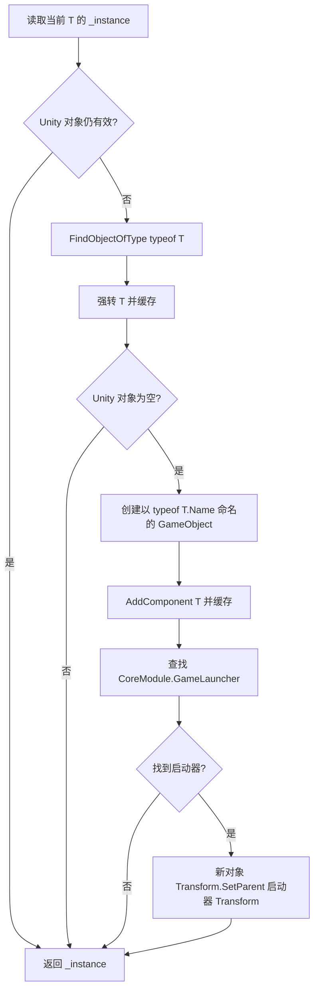

# 13 单例与事件初始化：恢复真实对象、字段和回调语义

更新日期：2026-10-19。状态：**两个原业务文件已写回；单例绑定静态审查与独立编译通过，事件实际源码的 19 场景 / 49 检查通过。Unity 场景中的对象创建、生命周期及启动仍由主流程统一验收。**

本批仅修改原工程的 `ToolModule/ManagerBase.cs` 和 `EventModule/EventManager.cs`，没有创建替代管理器或把实验 DLL 放进 Unity。两份 `.meta` 保持不变；本报告的成员不重复计入第 09 报告的 108 个自动恢复成员。

## 1. 为什么要先恢复这两个底座

大量业务管理器继承 `ToolModule.ManagerBase<T>`。其 `Instance` 原来导出为 `return null`，即使某个业务函数已经恢复，调用 `SomeManager.Instance` 也不能得到原 Unity 组件。

EventManager 的方法体原先为空，两个 readonly 字典没有初始化。恢复界面或数据方法不能弥补缺失的事件注册、触发和初始化通知。必须先把对象、字段和回调顺序接回真实调用链。

## 2. 先解决同名类型和共享泛型地址问题

APK 同时含有 `ToolModule.ManagerBase<T>` 与 `QuickTutor.Demo.ManagerBase<T>`。它们不是同一个底座。

| 目标 | 可信地址与签名 | 关键区别 |
|---|---|---|
| `ToolModule.ManagerBase<T>.Instance` | `0x5978460`，仅传 `MethodInfo*` | static 泛型 getter，没有 this 参数 |
| `ToolModule.ManagerBase<T>.CreateSubController<T2>` | `0x48802B4`，self + `MethodInfo*` | 泛型实例方法 |
| `ToolModule.ManagerBase<T>` 构造 | `0x5978848` | 只调用 MonoBehaviour 构造 |
| `QuickTutor.Demo.ManagerBase<T>.Instance` | `0x59780F0` | 本批没有修改 |

`dump.cs`、`script.json`、Cpp2IL 的 `MethodsByAddress` 和 IDA 的函数起止地址共同校验了以上映射。共享泛型版本里的 `object` 是 IL2CPP 代码共享形式；原 C# 仍保留 `where T : MonoBehaviour`、`where T2 : MonoBehaviour`，不添加 `new()` 约束。

原元数据只声明一个静态字段 `_instance`，Token `0x04001AAE`、静态偏移 0。恢复继续使用它，让每个闭合泛型类型自然保存各自的单例。

## 3. Instance 的原生语义



关键证据：

- `0x5978508` 调用 `UnityEngine.Object.op_Implicit`，因此保留 Unity 对象真假语义，已销毁对象也会重新进入查找流程。
- `0x5978570` 调用 `Object.FindObjectOfType(System.Type)`；找到的原场景组件会直接缓存并返回，只有新建对象会进入后续挂接分支。
- `0x59786E4` 的虚调用对应 `System.Reflection.MemberInfo.get_Name` 的 slot 8，所以对象名使用 `typeof(T).Name`。
- `0x597870C` 为 `GameObject(string name)`，`0x5978730` 为 `AddComponent<T>()`。
- 元数据地址 `0x8D34F28` 明确映射到 `Object.FindObjectOfType<GameLauncher>()`；原源码所属类型为 `CoreModule.GameLauncher`。
- `0x59787F4` 对应 `Transform.SetParent(Transform p)` 的单参数重载，没有改成 `worldPositionStays=false`。

整段没有直接调用 `DontDestroyOnLoad`，也没有调用 `Init()`。本批没有添加这些行为。新管理器挂到启动器后，其持久化取决于启动器本身的生命周期；该部分属于后续真实启动链恢复。

## 4. 子控制器与基类构造

`CreateSubController<T2>()` 的原生链路是：

1. 取 `typeof(T2).Name`。
2. 创建 GameObject。
3. `AddComponent<T2>()`。
4. 取新组件的 transform，调用 `SetParent(this.transform)`。
5. 返回新组件。

每次调用都创建一个新子控制器，没有单例查找或复用，也没有补充 Init/DontDestroyOnLoad。

基类构造的原生只有 8 字节：设置隐藏 MethodInfo 参数后跳转 `UnityEngine.MonoBehaviour::.ctor()`。原 C# 的空构造块会隐式调用 base 构造，编译后 IL 已确认含有该调用，因此这里不需要凭空增加其他构造逻辑。

## 5. EventManager 的真实字段初始化顺序

原构造地址 `0x3F11C88` 依次：

```text
new Dictionary<string, Action<object>>() → this + 0x20
new Dictionary<string, Action<object>>() → this + 0x28
调用 ManagerBase<EventManager> 构造
```

因此在原 readonly 字段声明上恢复真实初始化器。这样编译器把两个字典的构造与赋值放在 base 构造之前，和原 ARM64 一致。

实际源码编译后的构造 IL 已确认：两个 `newobj` / `stfld` 均位于 `ManagerBase<EventManager>::.ctor` 调用之前。表面上的构造块依旧没有额外语句，但其生成的方法体包含真正的字段初始化和基类构造，并不是占位构造。

## 6. 注册、注销、一次性与异常顺序

| 方法 | 原生 RVA | 恢复的行为 |
|---|---:|---|
| StartListening | `0x3F07F3C` | 现有非空委托使用 Combine；否则写入传入委托 |
| StopListening | `0x3F05D94` | 对 TryGetValue 得到的委托执行 Remove，再写回；最终 null 值的 key 仍保留 |
| StartListeningOnce | `0x3F119B4` | 同上注册规则，作用于 `+0x28` 一次性字典 |
| StopListeningOnce | `0x3F11B48` | 同上注销规则，作用于一次性字典 |
| TriggerEvent | `0x3F05F64` | 普通回调先执行；随后查一次性字典，先 Remove key，再调用一次性委托 |

这里有几个会影响真实行为的细节：

- 普通回调中新增的一次性监听，会被本次触发随后读取并执行。
- 一次性回调在执行前已移除，所以重入不会重复执行旧的一次性监听。
- 一次性回调中再次注册的监听，保留到下次触发；不能把 Remove 放到回调之后。
- 普通回调抛出异常时，后面的普通回调和一次性处理都不继续，一次性 key 仍在。
- 一次性回调抛出异常时，它所属的一次性 key 已被移除；后续同一委托列表不会继续。
- 多播委托保留注册顺序，Remove 只移除最后一个匹配项；不能替成集合去重或“全部移除”。

原 ARM64 的 EH 尾段没有吞异常：`0x3C38CF8` 是单参不返回 thunk，调用 `0x3C209A8`；后者分配异常 wrapper、保存原异常指针并调用 C++ throw，没有 `Exception::Raise` 的 PrepareException 步骤。安装版 libil2cpp 的 `Exception::Rethrow` 源码提供了独立结构对照。本批让相同异常对象继续传播，没有增加忽略错误的 catch。

## 7. 从原元数据修复一个容易漏掉的默认参数

原 metadata 中 `TriggerEvent.parameter` 的属性为 **Optional | HasDefault**，默认值是 **null**。导出 C# 却只有 `[Optional] object parameter`，这种声明在 C# 省略参数时可能传入 `Missing.Value`。

恢复成 `object parameter = null` 后，实际编译 IL 含 `.param [2] = nullref`，独立测试同时验证省略参数收到 null，以及反射参数的 IsOptional / HasDefaultValue / DefaultValue。

## 8. Init 的证据与导出状态机处置

`Init` 包装方法为 `0x3F11934`，`MoveNext` 为 `0x3F11D30`。MoveNext 只把状态置为 -2，并在有 runner 时调用 slot 2。

元数据地址 `0x8CE9038` 解析为 `Cysharp.Threading.Tasks.CompilerServices.IStateMachineRunnerPromise`；原类型定义中 slot 2 正是 `SetResult()`。没有 await、配置读取、事件注册或其他游戏行为。

所以实际方法恢复为 `return UniTask.CompletedTask;`，并去掉已不适用的 AsyncStateMachine 标注。导出的私有状态机结构暂留作来源材料，没有执行入口，本批不把其中空 MoveNext/SetStateMachine 算成已恢复业务逻辑。

## 9. 验证结果与限制

| 验证 | 结果 | 能证明什么 |
|---|---|---|
| ManagerBase 实际源码，netstandard2.1 / C# 9，真实 Unity CoreModule 与 UniTask | 0 错误、0 警告 | 单例/子控制器 API 与泛型绑定成立 |
| ManagerBase + EventManager 两实际源码合并编译 | 0 错误、2 个 CS0436 警告 | 源码可编译；两警告来自隔离项目借用 Dummy 元数据声明 GameLauncher 时的同名类型影子，编译器明确选用当前源码 |
| 编译 IL 审查 | 通过 | Unity Object 比较、Find/AddComponent/SetParent 重载，字段初始化先于 base，默认参数为 null |
| 事件实际源码提取测试 | **19 场景、49 检查、0 失败** | 注册/取消/重复、一次性、重入、修改监听、异常身份与顺序、null key、默认参数和立即完成 Init |
| 空壳负对照夹具 | **38 检查、34 失败** | 检查能够发现未恢复正文与缺失字典初始化；仅修改 work 下测试夹具 |
| Unity 实际对象与场景运行 | 尚未由本阶段执行 | 不把编译和独立回调测试当成 PlayMode 验收 |

测试程序从最新工程文件用 Roslyn 提取实际字段初始化器、构造块和方法正文，没有手工维护另一份事件实现。隔离夹具使用普通测试宿主承载这些纯 Dictionary/Delegate 行为；它不模拟 Unity 原生对象生命周期。

独立编译项目引用真实 Unity CoreModule 与已编译真实 UniTask；Dummy Assembly-CSharp 只提供尚未整体编译成功的 GameLauncher 类型元数据，不执行其方法体。测试程序集没有导入游戏工程。

## 10. 复现命令与证据

在工作区根目录执行：

```powershell
dotnet build work/singleton-recovery/compile/SingletonCompile.csproj -c Release
dotnet work/il-recovery/source-injection/tool/bin/Release/net10.0/SourceBodyInjector.dll . event-fixture
dotnet run --project work/event-recovery/tests/EventTests.csproj -c Release
```

证据目录为 `证据/单例与事件/`，包含两份当前源码快照、原 IDA/Cpp2IL 汇编与伪 C、泛型和调用映射、默认参数元数据、实际编译 IL、测试代码、源码正文哈希与测试日志。

本批源码仍在整体工程依赖与编译修复过程中。GameLauncher 的等待顺序、资源加载、登录成功门槛和后续管理器初始化将在第 15 报告继续恢复，不能用“所有方法立即完成”绕过这些真实依赖。
