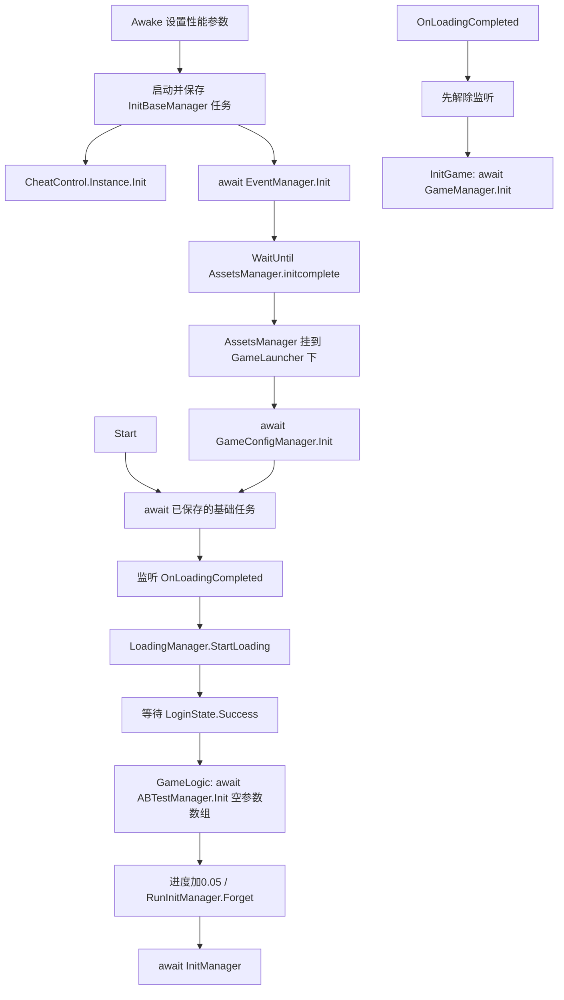

# 15 GameLauncher：恢复原启动顺序、等待、事件与性能设置

更新日期：2026-10-19。状态：**原 GameLauncher.cs 的 19 个业务方法已写回；真实 Unity / URP / UniTask 引用下独立编译 0 错误，源码控制流夹具 23 场景 / 87 检查通过。仍未达到真实游戏启动或核心玩法运行验收。**

本批仅修改 `Assets/Scripts/Assembly-CSharp/CoreModule/GameLauncher.cs` 一个业务文件。保留原脚本 GUID、全部 `.meta`、Token、RVA 来源标记及原业务字段，不向工程安装实验 DLL。主流程统一执行 Unity 导入；本阶段没有启动 Unity 或 PlayMode，也没有修改完成标志、强行设置登录成功、替换真实管理器。

## 1. 原空壳与本次恢复边界

原导出文件的 Awake、Start、事件、初始化方法体均为空，返回 UniTask 的方法为 `return default`。第 13 阶段恢复的 `ToolModule.ManagerBase<T>` 与 EventManager 能创建对象、分发事件，但不会自动补回启动器的等待和调用顺序。

本批直接恢复原类的生命周期和调用方法，没有新增替代启动组件。C# `async` 重新生成真正的状态机。原手写导出结构中的空 MoveNext / SetStateMachine 暂留作来源材料；它们没有执行入口，不计入已恢复方法。删除七个已不适用的旧 AsyncStateMachine 标注，编译产物会指向七个新生成状态机。

## 2. 方法与原生地址

| 恢复方法 | 原入口 RVA | 执行正文依据 |
|---|---|---|
| Awake | `0x4190F40` | 同地址伪 C + ASM |
| InitBaseManager | `0x41911B8` | MoveNext `0x4192988`；资源 predicate `0x419234C` |
| Start | `0x4191244` | MoveNext `0x4195B70` |
| Login | `0x41912D0` | MoveNext `0x419541C`；登录 predicate `0x419239C` |
| GameLogic | `0x419135C` | MoveNext `0x4192468` |
| RunInitManager | `0x41913E8` | MoveNext `0x41957D8` |
| InitManager | `0x4191460` | 完整 ASM `0x41935B4`；两个 predicate `0x41923F8` / `0x4192418` |
| StartBackgroundManagersInit | `0x41914F8` | 本阶段补取伪 C + ASM |
| LoadingCompleted | `0x4191894` | 本阶段补取伪 C + ASM |
| StartLoadingCompletedListening | `0x41919FC` | 本阶段补取伪 C + ASM + 字符串与 MethodInfo |
| StopLoadingCompletedListening | `0x41918A4` | 同上 |
| InitGame | `0x4191974` | MoveNext `0x41932A4` |
| SetOptimalPerformanceSettings | `0x4190FFC` | 本阶段补取伪 C + ASM |
| ApplyThirtyFpsRenderingSettings | `0x4191AD0` | 同上 |
| ApplyThirtyFpsLightingSettings | `0x4191BDC` | 同上 |
| DisablePostProcessingForLoadedCameras | `0x4191D50` | 同上，并用原字段和真实 URP API 交叉核对 |
| TrySetRendererFeatureActive | `0x4191EA4` | 同上；正常循环用 ASM 复核 |
| TryGetDefaultRendererData | `0x4192068` | 同上；反射 flags、类型、下标及 out 写入均复核 |
| TrySetPropertyOrField<T> | `bool` 版本 `0x4C8CDC0`；完全共享泛型 `0x4C8CF78` | 两个泛型实例正文共同确认，恢复通用 C# 方法 |

构造 `0x41922E0` 只有 MonoBehaviour 基类构造，原 C# 空构造隐式执行相同基类调用；不重复算成新增恢复方法。

## 3. 实际启动次序



`Start` 等待 Awake 中保存的原任务，不能新开一个基础初始化任务。登录条件精确为 `L_Tools.LoginControl.I.Curloginstate == LoginState.Success`；Pending 与 Fail 均继续等待，没有超时后强制进入业务。GameLogic 等待 ABTest 完成后才增加进度和发起后续初始化。

## 4. InitManager 的三个早期任务与 11 个等待位置

完整 InitManager 的 Hex-Rays 长时间未返回，是已知工具限制。本批没有把未完成伪 C 当成证据，也没有再次等待大型反编译。恢复以完整 ARM64 状态跳转、任务保存位置、11 个 resume case、方法元数据和第 08 阶段候选为依据。

在第一处 await 前，原方法依次发起：

1. `UniTask.WaitUntil(CustomBundlesManager.Instance.PreloadTaskCompleted)`，任务保存到原状态机 `+0x20`。
2. 进度 `+0.05`，启动 `TimeManager.Init()`，任务保存到 `+0x30`。
3. 再加 `0.05`，启动 `DataManager.LoadConfig()`，任务保存到 `+0x40`。

这三个任务不能改成三次依次 await。后续等待顺序为：

| 原 state | 等待项 | 下一阶段的条件 |
|---:|---|---|
| 0 | HWIAPManager.Init | 完成后加进度，再进入 DataManager.Init |
| 1 | DataManager.Init | 完成后 UIManager.Init |
| 2 | UIManager.Init | 完成后等待已经发起的 LoadConfig 任务 |
| 3 | loadConfigTask | 完成后 DataManager.LoadData |
| 4 | DataManager.LoadData | 加进度；再读 LoadDataCompleted |
| 5 | 仅在 LoadDataCompleted 为 false 时 WaitUntil 此标志 | 标志为 true 才进入用户资源初始化 |
| 6 | UserResourcesManager.Init | 完成后加进度，再初始化相机 |
| 7 | CameraModule.CameraManager.Init | 完成后加进度，再等待早期两个任务 |
| 8 | WhenAll(customBundlesManagerTask, timeManagerTask) | 两者均完成后加进度 |
| 9 | CustomBundlesManager.Init | 完成后加进度 |
| 10 | UIManager.GetPanel | 预取 NoInternetPanel 完成后才继续 |

预取地址保持：`Assets/_Res/Addressable/01FirstBundle/Prefabs/UI/Panels/NoInternetPanel.prefab`。没有在此调用 ShowPanel 或改为其他导出路径。

整个 InitManager 共有十次 `AddCurrentMaxProgress(0.05f)`。预取面板后输出原日志“需要等待的必要相关管理器初始化完成”，再增加进度、发起后台管理器初始化。原 `WhenAll` 只包含资源预载等待和时间任务，不把 17 个后台管理器改成同步等待项。

依赖任务抛出异常时，新编译状态机保留 GetResult / SetException，后续初始化不继续。没有增加吞异常 catch 或返回立即完成任务。

## 5. 后台 17 个管理器与首次进入时间

原方法依次调用下列管理器的 `Init().Forget()`：

```text
FeatureUnlockManager → AudioManager → UIHUDManager → EffectManager
→ UITextEffectManager → MaterialsManager → SteerManager
→ CheckStayGetRewardManager → ReportEventsManager → PanelPopHandleManager
→ PacksTipManager → PropDetailsManager → AdButtonManager → AnnouncementManager
→ ResourceObtainGuideManager → CheckInRewardManager → SubGameChaosTrailsManager
```

每个调用的真实类型通过各自 ManagerBase 泛型 MethodInfo 解析，避免把共享原生名 `ManagerBase<object>` 当成业务类型。

后台发起之后，只有当 `PlayerCoreData.firstEnterGameTime == DateTime.MinValue` 才写入并保存：`PlayerGuideData.isFirstThroghGame` 为 true 时取 `TimeManager.GetNetworkTime(false)`；为 false 时取同一时间并 `AddDays(-4)`。已有时间戳保留，不调用 Save，也不替换成本机 DateTime.Now。

## 6. 加载完成事件

元数据字符串 `0x8D69BA8` 为 **OnLoadingCompleted**；MethodInfo `0x8D2D1E0` 指向本类 LoadingCompleted。监听状态为原字段 `_isLoadingCompletedListening`（原对象偏移 `0x30`）。

StartListening 成功后置 true；重复 Start 不再注册。StopListening 成功后置 false；重复 Stop 不重复注销。LoadingCompleted 先调用 Stop，再调用 InitGame。这与 LoadingScene 在等待 GameManager.InitComplete 之前发 OnLoadingCompleted 的原顺序相接。

原方法没有 OnDestroy 自动解绑入口，本批也没有凭空增加。InitGame 的 async-void 调用形状保留，其正文真实 await GameManager.Init。

## 7. 性能与反射辅助函数

Awake 的实际性能方法读取内存、compute 支持与当前 URP：低于 3072 MB 使用 30 FPS / renderScale 0.75；其余使用 60 FPS / 0.8。有 URP 但不支持 compute 时，再将 renderScale 降 0.1、最低 0.7，并把 FPS 限到最多 30。没有 URP 时只按内存设置 FPS。

三个 thirty-FPS 辅助方法也按原正文恢复，但原 SetOptimalPerformanceSettings 没有调用它们，因此没有自行加调用。显式调用渲染辅助时会设置 MSAA=1、关闭四种原光照字段、关闭已加载相机的 post processing / antialiasing，并尝试关闭名字为 Render Effects 的 RendererFeature。

反射行为保留以下细节：

- TryGetDefaultRendererData 先清空 out；先找非 public 实例属性 `scriptableRendererData`，再找私有字段 `m_RendererDataList` 与 `m_DefaultRendererIndex`；检查 int 下标与数组范围。
- TrySetPropertyOrField 的属性 flags 为 Instance | Public | NonPublic，使用 `GetSetMethod(true)`，支持私有 setter；无 setter 才退回 Instance | NonPublic 字段。原字段 flags **不含 Public**，没有擅自扩大。
- setter 优先于字段；未找到返回 false；反射 setter 抛错继续传播，没有吞异常。
- RendererFeature 名字使用 OrdinalIgnoreCase；找不到和取不到默认 RendererData 分别输出原日志并返回 false。

部分短方法伪 C 含局部变量分配警告或在异常尾部显示越界 JUMPOUT。正常分支以 ASM、原签名和字段偏移复核，未把错位实参直接复制到 C#。匹配版本 URP14 源码确认了 MSAA、相机开关和 SetActive API 的具体字段行为。

追加边界审查：本阶段补取的 13 个短原生方法又用主流程的边界脚本重新处理，在自动分析和定义被调用方法后再次校正函数 end，逐个确认 IDA actual_function_start / end 与 metadata 目标一致。保留真实外跳的运行时 helper；没有盲删 jump island。证据为 `native/status-bounded.json`。

## 8. 验证结果

| 验证 | 结果 | 能证明的范围 |
|---|---|---|
| 实际 GameLauncher.cs，netstandard2.1 / C#9，真实 Unity 2022.3 / URP14 / UniTask 引用 | **0 错误，6 个 CS0436 警告** | 源码和真实 API/async task builder 可编译。警告仅为隔离项目借用 Dummy Assembly-CSharp 提供其他类型时，同名 GameLauncher 的旧嵌套字段引用；编译器选当前源码 |
| 实际编译 IL 审查 | 七个新 async 状态机，await 数依次 3/1/1/1/1/11/1，均含 SetResult 和 SetException | 没有接到旧空 MoveNext；InitManager 生成 11 个等待位置 |
| 从实际 19 方法正文提取的控制流夹具 | **23 场景 / 87 检查 / 0 失败** | 等待顺序、资源/登录条件、异常中断、监听幂等、17 后台顺序、时间迁移分支、性能/反射正常与失败路径 |
| 恢复前空壳负对照 | **23 场景 / 23 检查 / 23 失败** | 同一夹具能够识别缺失正文。仅为编译负对照，为原先非法 out stub 加 null 赋值；没有写回业务源码 |
| .meta 比较 | SHA-256 与备份相同 | 原脚本身份不变 |
| Unity 整体编译、场景加载、PlayMode、可视和手工核心玩法 | **不由本阶段执行，尚未验收** | 不能从独立编译或夹具外推真实运行成功 |

夹具从当前源码提取正文，只在 work 下把 UniTask 类型替换为 Task，并把 WaitUntil 接到可手动 Tick 的谓词调度器。Unity、Manager、资源和 SDK 均用测试适配器控制完成时机。这是为了检验源码是否正确等待；它不会验证 UniTask player loop、真实 Unity 对象生命周期、资源、平台服务或各 Manager 的实现。实际 UniTask builder 与真实 API 绑定由另一项实际源码编译和 IL 检查覆盖。

## 9. 仍阻止真实运行的依赖

以下为本阶段读取工程源码时确认的依赖状态；主流程并行恢复的 AssetsManager 首批已在报告归档前重新读回标明。不能用主启动器旁路这些生产者和消费链：

| 位置 | 当前缺失 | 直接影响 |
|---|---|---|
| CheatControl 的 `L_Tools.Singleton<CheatControl>.Instance` | getter 仍返回 null，嵌套静态实例没有真实初始化 | Awake 发起基础任务后，CheatControl.Instance.Init 会失败；它与已恢复的 ToolModule.ManagerBase 不是同一底座 |
| `QuickTutor.Singleton<ABTestManager>.Instance` | getter 仍返回 null，Lazy 静态初始化缺失 | 登录成功之后 GameLogic 仍无法取得真实 ABTestManager |
| `CustomBundlesManager.Instance` / PreloadTaskCompleted / Preload / Init | 自有单例返回 null，完成 getter 为 false，操作为空任务 | InitManager 的早期预载 gate 无真实生产者；还需恢复本地化资源链 |
| AssetsManager.Init / GenerateGroupsMap 及首次 ProcedurePreLoad 资源启动 | 主流程已并行写回 Init / GenerateGroupsMap 首批，读回可见最后置 initcomplete=true；其 Resources 配置、解析、ObjPool 和更早的 ProcedurePreLoad 仍需完整验证 | 本报告的夹具只控制该标志，未验证实际资源生产者与框架登录流程 |
| GameConfigManager.Init、ABTestManager.Init、HWIAPManager.Init、TimeManager.Init | 真实业务初始化仍是空壳 | 即使 task 形式立即完成，也没有所需配置、SDK或时间数据 |
| DataManager.Init / LoadConfig / LoadData / LoadDataCompleted | 操作为空任务，完成 getter 仍返回 false | 数据配置缺失，后续真实等待不会得到有效数据完成信号 |
| DbtSaveDataManagerBase<T,TD>.I / Data / Save | 实例、Data getter 和数据存取仍需恢复 | 首次进入时间迁移没有真实数据对象和持久化 |
| UIManager.Init / GetPanel、UserResourcesManager.Init、CameraModule.CameraManager.Init | 原业务/资源装配未恢复 | UI、用户资源和相机仍未初始化 |
| 后台 17 个 Manager.Init 与 Tutorial/LoadingManager 真实状态机 | 业务方法、完成信号和对象装配尚未闭合 | 加载进度、教程门槛和完成事件仍不能视为有效 |
| GameManager.Init 及后续战斗场景/单位/格子/存档链 | 原核心业务方法仍需逐段恢复与运行验证 | LoadingCompleted 即使触发，也不能证明核心玩法可玩 |

首个新增后继任务为精确恢复三套仍缺失的单例底座，不改业务完成 flag；后续记录在第 17 报告。主流程仍要继续处理整体脚本依赖、首场景框架入口和 Unity 导入层诊断。

## 10. 产物、哈希与复现

修改前备份：`work/recovery-stubs/game-launcher-before/GameLauncher.cs` 与 `.meta`。

- 修改前源码 SHA-256：`fc5611c2e5091db1175dd63fc722e84f2ba5303453dcdc9dda43211c15aac507`。
- 修改后源码 SHA-256：`437b3dfddb47e0813a63019b9d78a5f484efb213615c662d2c66901ce045335a`。
- 修改前后 .meta SHA-256：`249a9997c419f406e8f77685e1ff943100cb3b476679f528ab1a780806d078e3`。

工程根目录可复现：

```powershell
dotnet build work/game-launcher-recovery/compile/LauncherCompile.csproj -c Release
& 'C:/Users/luxinyu/AppData/Local/Programs/idapromcp/source/.venv/Scripts/python.exe' work/game-launcher-recovery/make_fixture.py
dotnet run --project work/game-launcher-recovery/tests/LauncherTests.csproj -c Release
& work/tools/ilspy-recovery/ilspycmd.exe --ilcode -t CoreModule.GameLauncher work/game-launcher-recovery/compile/bin/Release/netstandard2.1/LauncherCompile.dll
& 'C:/Users/luxinyu/AppData/Local/Programs/idapromcp/source/.venv/Scripts/python.exe' work/game-launcher-recovery/audit.py
```

工作产物集中在 `work/game-launcher-recovery`，补充 IDA 证据为其中 `ida/pseudocode`，旧启动正文在第 08 报告所列目录。对照备份、当前源码、原生正文、精确目标、元数据参照、测试源码/日志、编译日志、IL 和审查 JSON 已归档到 `证据/GameLauncher启动/`。归档不包含约 944 MB 的临时 IDA 数据库。
