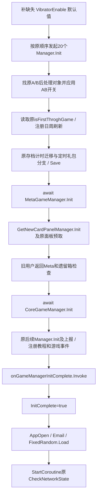

# 29 GameManager 原始初始化恢复

更新日期：2026-10-19。状态：**16 个原业务方法、10 段原 lambda 和原 UpdateController 字段初始化器已窄写回实际 GameManager.cs；实际源码与已验证候选逐字节一致，实际源重编、控制流复测及 IL 读回通过。**主流程在第 33 阶段时间生产者落盘后解除本文件冻结；网络协程的原前置紧循环没有添加 yield、跳过条件或伪造完成标志。

实际完整源码独立编译 0 错误；从实际源码提取的适配控制流测试 30 场景 / 227 检查通过，其中月卡 float32 数值有 143 组原 ARM64 对照。原空壳负对照 30 场景全部失败。尚未声称原场景、地图、开格或战斗可运行。

## 1. 单文件范围和实际写回位置

唯一修改业务文件为 `Assets/Scripts/Assembly-CSharp/GameModule/GameManager.cs`。已重新读取主程序集编译修复后的实际源码，没有覆盖其他代理的新诊断或已有字段恢复。原 GameManager 字段、原 Token / RVA 标注、全部嵌套导出壳和 `.meta` 均保留。没有修改 CoreGameManager、BattleGameManager、TimeManager、存档数据或其他源文件。

- 候选：`work/gamemanager-recovery/GameManager.candidate.cs`。
- 窄变换生成器：`prepare_candidate.py` 和五份实际方法正文输入。
- 原源码备份：`work/recovery-stubs/gamemanager-before/GameManager.cs` 与 `.meta`。
- 变更前工程源 SHA-256：`610632e7b88d4fcde29cfdec801a80b128630e33caa729ff73ddce83398db13b`。
- 候选及实际恢复源 SHA-256：`056d6972fbea4a73a8d302f0660cc2eba9e0ab600cafc140c2c67d26d351f8fb`。
- 原 `.meta` SHA-256：`019e13e126bf11987b56f0677d2c6ccf95dc714f3d9aa66e6f9c6d8ef6c22648`，当前未变。

实际源码已经按候选窄应用，并以 `-p:Actual=true` 独立重编。夹具重新从工程实际文件提取正文，30 场景 / 227 检查重新通过；实际编译 IL 已导出至 actual.il.txt 并通过 final-audit.json。上述状态只表示源码和独立验证完成，Unity 统一导入和实际核心场景验收由主流程继续负责。

## 2. 原生证据与方法身份

先从原 ELF 按 metadata 边界提取所有 GameManager 方法、闭包和状态机的完整 ARM64，再解析 relocation 指针槽到真实 MethodInfo / 类型 / 字符串。随后在独立 IDA 数据库补取 41 个短方法，以及一次性尝试两个大方法：Init.MoveNext（8,148 字节）和原 PVP 奖励 lambda（4,188 字节）。本次两大方法均成功，没有重复等待挂起的 Hex-Rays 任务。

43 项 IDA 实际函数起止均与 metadata 匹配。仅旧迭代器 Reset 的异常尾部带 JUMPOUT，本批不调用该旧壳；新的编译器迭代器自然生成 Reset/Dispose。其他关键方法无 unresolved JUMPOUT；奖励伪 C 的局部变量分配警告以完整 ASM、原签名和字段偏移复核，未直接复制错位实参。

| 候选恢复的原方法 | Token | 原入口 RVA | 状态机/闭包正文 |
|---|---|---|---|
| Init | `0x0600157A` | `0x3E197C0` | MoveNext `0x3E1D2F0` |
| RegisterOnGameManagerInitComplete | `0x0600157B` | `0x3E1984C` | 同地址 |
| Update | `0x0600157C` | `0x3E198F0` | 同地址 |
| CheckNetworkState | `0x0600157D` | `0x3E19928` | iterator MoveNext `0x3E1CAF4` |
| PauseGame | `0x0600157E` | `0x3E199B0` | 同地址 |
| ResumeGame | `0x0600157F` | `0x3E19AB8` | 同地址 |
| StartCoreGame | `0x06001581` | `0x3E19BC0` | 奖励 lambda `0x3E1AB50` |
| EnterMeta | `0x06001582` | `0x3E19D38` | MoveNext `0x3E1CF94` |
| RegisterOnTimeToZero | `0x06001583` | `0x3E19DC4` | 五个日刷新 lambda |
| RegisterOnTimeToMonDayZero | `0x06001584` | `0x3E1A2C4` | 四个日/周 lambda |
| DanChangeUpdateInfo | `0x06001585` | `0x3E1A5B8` | 同地址 |
| ShowCardProbabilityPanel | `0x06001586` | `0x3E1A608` | MoveNext `0x3E1F2D0` |
| ShowConfirmPanel | `0x06001588` | `0x3E1A694` | 同地址 |
| FetterSteerEnd | `0x06001589` | `0x3E1A864` | 同地址 |
| CloseLoadPanel | `0x0600158A` | `0x3E1A918` | 同地址 |
| LoadEnd | `0x0600158B` | `0x3E1A9EC` | 同地址 |

原构造 `0x3E1AA70` 在 ManagerBase 构造前创建并写入 UpdateController。因此在原字段声明上恢复 `new UpdateController()` 初始化器，保留原空构造。原 CheckMonthPass、CardSteerEnd 的 native 只有 RET，现有空方法已等价，不增加臆测逻辑，也不重复计为新增恢复。

## 3. Init 的真实等待与完成信号

原 Init 只含 **两处 await**。首批二十个管理器和后续多个管理器的 Init 返回值在原 native 被忽略，不能凭“初始化”名字把它们改成顺序 await 或 WhenAll，也不能反过来把两个真正的 await 去掉。



前二十项依次为 HWLeaderboard、HomelLandCtrl、HomelLandCtrlNew、Badge、Box、Arena、ArenaProgress、TrainingGround、TrophyProgress、PlayerCustomization、PlayerLevel、UserLable、UserLablePushPack、MetaBtnSecondClick、Skin、MonthlyPass、DailyBless、SynergyEffect、RoleShadow、GameCenter。每个真实泛型 MethodInfo 均解析到原所属类型，未把共享名 ManagerBase<object> 当成业务类型。

InitComplete 是原字段 Token `0x04002AC4`、对象 offset `0x20`。其唯一写入在 **`0x3E1E894`**，位于原完成回调调用后，AppOpenEvent 前。候选编译 IL 同样只有一处写入，顺序已审查。

几个会影响行为的后果必须保留：

- Meta 或 Core 的等待任务失败时，后续阶段不继续，InitComplete 仍为 false。
- 完成回调执行时看到的 InitComplete 仍为 false；回调抛错会阻止 true 写入。
- true 写入之后的 AppOpen、邮件或其他服务失败时，Init 任务会失败，但原字段已经为 true；没有回滚字段。
- RegisterOnGameManagerInitComplete 在 false 时 Delegate.Combine；true 时立即调用传入 action 并返回。原回调列表不清空，不改成一次性事件。
- Update 只有 InitComplete 为 true 才向原 UpdateController 传入 Time.deltaTime。

没有把其他 Manager 的完成状态写成 true，没有新建“全局就绪”替代标志。

## 4. 存档、计时迁移、教程与事件前置

保留原 `_isFirstThroghGame` 从 PlayerGuideData 读取，而不是按是否有当前场景推测。两个真实后处理对象路径 `Base/ATestPostProcess` / `Base/BTestPostProcess` 及 WeeklyClashImprove02IsBTest 的相反开关保持；对象缺失仍由原调用失败，不创建替代对象。

计时迁移包含：先清 timingPushGiftPackageCdIng 并 Save；hadHandleTwoSixOneBug 为 false 时检查原计时器日期，旧于 2025 的开始时间或不晚于 2024 的目标结束时间按原分支 Restart（2 天或 4 天），再写迁移标志并保存 Shop/Time 数据。没有用 DateTime.Now 覆盖存档，没有省略迁移，年份阈值来自原立即数。

SelectableOffer 分支保留首次进入四天计时、旧用户已有计时查找、新手礼包存在时按“四天减原剩余时间”创建计时，以及新手礼包不存在时原允许推送和 offset 计时器查找。相同 Save、日志与调用顺序均保留。

日刷新方法先注册原 Shop 的 RefreshUserUniversalCardData、ResetWatchAdCount、ResetPopPacks，再注册广告/免费资源、订阅、插屏、箱计数与 AB 日祝福回调。周相关方法保留实际 RegisterOnWeekPassed / RegisterOnTimeToZero 的不同重载，不把名字含 MonDay 的所有回调误改成每周执行。字典键先 ToList 再更新，避免改成枚举过程中改变集合。

原订阅日回调修改 CoreData.nowLingquReward 后调用的是 **PlayerAdData.Save**；候选按真实 native 保留，没有顺手纠正成另一个 Save。每日计数、赛季计数、DailyNoBetGoldEarned、每周计数和符石购买状态按原字段偏移写回。

Meta await 后 GetNewCardPanelManager.Init 返回值不等待；旧用户预取 ClimbRankPanel、进入原 Meta 页并触发 InitGameEndCheckIsHasLegacyBox。FoundEnemyPanel 也只预取后才等待 Core.Init。教程步骤 1009 / 1016 决定两个事件的监听，初次进入的 DanChange 在注册监听后触发。所有事件仍指向原 GameManager 方法和原 EventManager。

## 5. 真实核心启动与奖励回调

LoadEnd 只在原 `_isFirstThroghGame` 为 true 时触发 OnArenaUIBGItemStartBtnClicked；事件由 Init 注册到 StartCoreGame。StartCoreGame 保留原 BattleContext 构造：showFoundEnemyPageOne=true、原奖励 Func<bool,RewardConfig>、其余原 null 回调、GameType=PVP，再交给 **CoreGameManager.StartGame(context)**。

奖励 lambda 不以“先让场景显示”为由删掉。训练场分支保留胜负经验和引导完成通知；普通胜利分支保留原金币/钥匙/经验/奖杯顺序、NoBet 金币记账、月卡加成、竞技场完成门、奖杯溢出扣回和赛季奖励。失败分支保留十秒门槛、竞技场已完成门、AB 可用奖杯上限与原 ChangeArenaTrophy 调用。

原新竞技场失败路径中，奖励配置里的负奖杯展示值会钳到已有奖杯，而 ChangeArenaTrophy 使用的是原配置 trophyPunish 的负值。候选保留这两个不同数值，没有未经授权重设计奖惩。

月卡金币 native 为 SCVTF(float32) → FMUL（原常量位 `0x3F99999A`，1.2f）→ FCVTZS(int32)。候选显式保留 float32 舍入与有限越界时的 int 饱和，避免当前 CLR 的越界浮点转 int 行为与原 ARM64 不同。输入来自 Int32，所以正无穷特殊分支在这条数据链不可达，未据此引入额外玩法。

原 48 字节指令片段 `0x3E1B2AC–0x3E1B2DC` 已在 Unicorn 独立执行，143 组 int 输入包括正负极限、float 精度边界和固定种子随机值。测试调用候选实际奖励 lambda，143 组输出与原指令全部相同。

普通奖励写入 BattleGameManager 的 rewardConfig / tempConfig 为同一个对象，再调用原 OnGameFinish。训练场提前结果不进入普通上报/字段写入路径。没有生成新 RewardConfig 或 BattleContext 替代类，也没有改动这些依赖的原构造和奖励应用实现。

## 6. 网络协程的原前置紧循环是整合门禁

原 CheckNetworkState 在 this 仍有效、InitComplete / TimeManager.initComplete / DataManager.LoadDataCompleted 任一为 false 时，**同次 MoveNext 内没有 yield，直接回到检查点**。完整 ASM 回边 `0x3E1CDF8` / `0x3E1CE0C` / `0x3E1CE20 → 0x3E1CDCC` 已证实。

初次准备候选时 TimeManager 的真实初始化生产者尚未恢复，因此本文件曾保持冻结。主流程随后完成第 33 阶段时间生产者的源码稳定点，明确允许接入，才写回本阶段候选。当前仍保留 Init / Time / Data 三个真实前置；GameLauncher / LoadingManager 需要真实 Data 完成后才会调用核心 Init。不能通过给协程补 yield、超时后继续、跳过检查或替别的 Manager 写 flag 来制造启动完成，本批未作这些修改。

前置满足后，原协程每轮先 yield 0.02 秒；教程 1008 完成后才检查网络。离线且未显示时，MaskPanel 正在显示会按原分支结束整个迭代器；否则 yield 原 ShowPanel 返回值，恢复后写本类 showNoInternetPanel 并暂停 Battle / AI。恢复网络时 yield HidePanel，恢复后清本类标志并恢复 Battle / AI。Pause/Resume 保留 Unity Object 的真假比较，没有设置 Time.timeScale。

EnterMeta 依据原训练场与 GameType 返回页；SubGamePVP 分支传递 `obj as BattleResult` 给原子玩法返回方法。原 EnterMeta 是 async-void，但没有 await；候选保留 async-void 的异常送交 builder 语义，没有为了消除 CS1998 改成同步事件异常。

CloseLoadPanel 先写本类 closeLoadPanel，再 ReportGameInteractive 原空字符串、按旧用户条件弹礼包、调用原 StartupGift 检查。ShowConfirmPanel 的五个实参顺序、ShowCardProbabilityPanel 的 0.05 秒等待与原面板地址、FetterSteerEnd 的 GameCenter AB 条件均保留。

## 7. 验证结果和限制

| 验证 | 当前结果 | 可证明的范围 |
|---|---|---|
| 实际完整 GameManager.cs，netstandard2.1 / C#9，真实 Unity / UniTask / 正式 Main 与 GFRunning 引用 | **0 错误，13 警告** | 原 API、字段、构造、泛型与 async builder 绑定可编译；警告为同名单文件影子、旧导出壳/保留字段及无 await async 等 |
| 实际源码正文提取的 Task / Unity 依赖适配夹具 | **30 场景 / 227 检查 / 0 失败** | 两次等待、回调/flag/异常顺序、存档计时分支、事件、日周、网络 yield、模式与奖惩分支 |
| 原空壳负对照 | **30 场景 / 13 检查 / 30 失败** | 能发现缺失方法和字段初始化，而不是只验证空任务形状 |
| 原 ARM64 月卡数值 oracle | **143 / 143 输入通过** | 实际候选回调的 float32 ×1.2 / FCVTZS 边界行为 |
| 编译 IL | **10 项关键检查通过** | Init 两个 await、卡牌提示一个 await、EnterMeta async 异常、回调在 flag 前/上报后序、唯一 flag 写入、新 iterator、原 Unity 比较、构造初始化在 base 前 |
| metadata / IDA 函数起止 | **43 / 43 匹配** | 方法身份与正文边界 |
| 工程源码 / .meta | **已写回并与候选逐字节一致；meta未变，原Token序列保留** | 实际工程源与既有候选对应 |
| 实际源码写回读回 | **通过** | 实际源与候选 SHA-256 一致，实际编译和测试已重跑 |
| 本阶段 Unity 编译、场景、视觉与原地图/开格/战斗验收 | **not-run** | 统一导入和 Play 由主流程后继负责，未把独立结果当成游戏运行 |

夹具已重新从实际工程源的完整 16 个正文提取，不手工维护第二份 GameManager 控制逻辑；但在 work 内把 UniTask 变成 Task，Unity、其他 Manager、存档和 UI 是可控依赖适配器。它验证何时调用/等待/写状态和故障中断，**不验证这些 Manager 的真实实现、资源、序列化或 Unity player loop**。

每个测试场景重新清理适配器状态；需要等待的任务可以独立挂起和释放。没有在 CLR 夹具中运行前置 false 的原网络紧循环，也没有把这个未运行边界说成通过。候选完整源码的另一项独立编译使用正式导入后真实 Main 程序集作为依赖元数据，而不是旧 Dummy DLL。

## 8. 仍需真实生产者和核心消费者恢复

本文件曾以 TimeManager.Init / InitializeTimeSource / initComplete 的原生产链和 Timer 真实行为作为整合前置。主流程第 33 阶段已经落盘时间生产者后授权写回；但实际 Data / Loading / 存档计时消费门仍必须由后继真实流程产生，不能用默认值完成。原时间入口仍可追溯：Init `0x3E451B4`、MoveNext `0x3F6EA3C`；时间源 MoveNext `0x3F6F450`；构造 `0x3E46E8C`。

同时，PlayerGuide / Shop / Time / Core 数据对象与 Save、TutorialManager.IsStepComplete、原二十余个 Manager.Init、UIManager.GetPanel / ShowPanel、CoreGameManager.Init / StartGame、BattleContext / RewardConfig 构造与奖励应用仍需沿当前真实源码继续恢复。CoreGameManager.StartGame 才通向原地图/单位/开格战斗；本批没有把它换成简化棋盘。

原 InitComplete 表示本方法完成到特定写入点，不等同于所有未等待后台 Manager、全部业务数据或整场战斗都已就绪。

## 9. 复现与归档

实际工程源复现：

```powershell
dotnet build work/gamemanager-recovery/compile/GameManagerCompile.csproj -c Release -p:Actual=true
& 'C:/Users/luxinyu/AppData/Local/Programs/idapromcp/source/.venv/Scripts/python.exe' work/gamemanager-recovery/make_fixture.py
dotnet run --project work/gamemanager-recovery/tests/GameManagerTests.csproj -c Release
& 'C:/Users/luxinyu/AppData/Local/Programs/idapromcp/source/.venv/Scripts/python.exe' work/gamemanager-recovery/audit.py --actual
```

`--baseline` 提取原工程备份空壳，生成负对照；不写业务源码。`emulate_month_bonus.py` 从原 ELF 读取代码和常量生成 143 组独立 oracle。所有实验 DLL 只存在 work。

候选及实际后态源码、实际前态、meta、窄 diff、43 项 native 证据、字段 Token/Offset、原字符串/泛型引用、编译 IL、测试/负对照、原生浮点 oracle 与 candidate-audit.json / final-audit.json 已归档到 `证据/GameManager初始化/`。没有归档约 944 MB 的临时 IDA 数据库。
