# 32. 首场景框架入口恢复

本阶段完成只读取证和分批恢复计划，**没有修改工程源码，没有启动 Unity，也没有宣称首场景已进入游戏**。当前首场景中 GameStartEntry、GameFrameEntry 与 GameStart 的关键业务方法仍为空；只补三个文件也无法闭合启动链，因为 IGameStart 的绑定／回调桥、版本与资源模块、旧 ConfigMgr 等真实消费者还需要恢复。

本次复用第 08 阶段 Awake `0x72E86A4` 与版本完成回调 `0x72E5DD0` 的伪 C／ASM，再以原始 ARM64 ELF 作有界本地反汇编，核对 104 个入口及相关候选方法，共 34,440 B 原生正文。这些候选包含混淆生成的相似方法，**104 不是拟修改的方法数**。原 DummyDll 的方法 Token／RVA 使用 PE 元数据读取器核实，没有加载或执行目标程序集。

## 1. 场景中的真正入口和本阶段边界

原 BuildSettings 的首场景为 `Assets/GameRes/BundleRes/Scene/MineGameMain.unity`。原 `Main` 对象上同时挂有 `GameFramework.Base.GameStartEntry` 和 `ljzs_lt.GameStart`，后者继承 IGameStart。当前导出场景也保存了对应启用组件及原 GUID。

场景原值为 `AppName=ljzs_lt`、`gameCode=U-CSZDZ`、`m_Fastmode=false`、`m_AutoSaveData=false`。保留这些原始值，不能打开 Fastmode 缩短初始化、手工设置版本／配置完成，或跳过第一道模块回调门。

第 28 阶段已经验证真实新 GlobalInfo 的当前 65 项配置消费，但那一轮没有执行首场景或 `DataManager.LoadConfig`。首场景这里使用的旧 `ljzs_lt.ConfigMgr` 与新 GlobalInfo 是不同消费者；第 28 阶段通过不能替代旧配置和框架启动验收。

拟保留三文件主范围：

- `GFRunning/GameFramework/Base/GameStartEntry.cs`。
- `GFRunning/GameFramework/GameFrameEntry.cs`。
- `Assembly-CSharp/ljzs_lt/GameStart.cs`。

必要的最窄范围扩展是 `GFRunning/GameFramework/Base/IGameStart.cs` 中三个实际桥方法。当前只提出扩展，尚未写源；其他模块依赖单列，不把整个框架无限并入一个修改批次。

## 2. 已确认的原始依赖图

```mermaid
flowchart TD
    A[MineGameMain / Main] --> B[GameStartEntry.Awake 0x72E86A4]
    B --> C[GetComponent IGameStart<br/>双向绑定真实 GameStart 与 Entry]
    C --> D[原 AppSetting/culture<br/>UserDataPrefs.OnInit<br/>BeforeGameFrameworkInit]
    D --> E[GetModule VersionMondule<br/>GameFrameEntry.Initialize]
    E --> V[真实 VersionMondule.Initialize/Init 协程]
    V --> F[原版本完成回调 0x72E5DD0]
    F --> G{原 UseNewRes 选择}
    G -->|新资源| H[NewResLoadHelper<br/>KeWan 或 YO backend<br/>原 team/play mode]
    G -->|旧资源| I[AssetbundleModule.Initialize<br/>真实 manifest 加载]
    H --> J[资源 backend 完成回调 0x72E692C]
    I --> J
    J --> K[AfterGameFrameworkInit]
    K --> L{原 UseNewRes 选择}
    L -->|新资源| N[UIModule.Initialize]
    L -->|旧资源| M[ResourcesModule.Initialize]
    M --> M2[旧 Resources 完成回调 0x72EAB28]
    M2 --> N
    N --> O[UI完成回调 0x72E8B14]
    O --> P[按原顺序发起 Lang/Fsm/MineLogic<br/>Time/Effect/ObjectPool/Procedure 初始化]
    P --> Q[Procedure模块完成回调 0x72E6FBC]
    Q --> R[GameFrameEntry.Start<br/>原路径/语言/GF_InitFinish<br/>真实 GameStart.InitPatchManager]
    R --> S[OpenLoadingUI 协程<br/>原日志、yield int 0一帧、回调]
    S --> T[IGameStart.LoadingUIShow 0x72EAE78]
    T --> U[Entry.LoadingUIOpened 0x72EA93C]
    U --> W{原资源配置分支}
    W -->|旧资源| X[ResLoadHelper.LoadAsset data/config]
    X --> Y[原资源回调 0x72E7FF4<br/>GameStart.InitConfig ResourcesInfo]
    Y --> Z[真实旧 ConfigMgr.Initialize]
    Z --> ZA[IGameStart.InitConfigOver 0x72EAE90]
    W -->|新资源| ZN[原 override/WebGL/InitConfig_newRes 分支<br/>本批不冒充已闭合]
    ZA --> ZB[Entry原逻辑初始化 0x72E5690]
    ZB --> ZC[原 RegisterProcedure/RegisterLogicCtr<br/>Audio/InitCtrl 非Fastmode/CommonSettings]
    ZC --> ZD[真实 GameStart.StartGame]
    ZD --> ZE[ProcedureManager.StartProcedure PreLoad]
    ZE --> ZF[已恢复的原 ProcedurePreLoad/StarGame]
```

图中的边是原调用关系，节点存在不代表其当前 C# 正文已恢复。尤其版本、资源、旧配置和 ProcedureManager/Fsm 桥仍不能用空实现自动推进。

## 3. 双向绑定及 Initialize 的准确契约

Awake 从 Entry 的 IGameStart 字段取对象，必要时执行实际 `GetComponent<IGameStart>()`，缺失时输出原启动失败错误并返回。存在时，原字节把 Entry 写入 IGameStart 的 `+0x20` 字段，再继续原初始化。当前 IGameStart 提供 Token `0x60071A8`、RVA `0x72EAE70` 的对应绑定方法，其原正文恰是一次字段存储；当前源方法为空。后续 C# 恢复应消费这个真实绑定方法，不新增替代入口或反射修改私有字段来绕过源契约。

Awake 最初的泛型槽 `0x8D2D198` 明确解析为 `GetModule<VersionMondule>()`，回调槽 `0x8D2E198` 为 `0x72E5DD0`。不能误恢复成“Awake 直接初始化 ResourcesModule”或“统一初始化所有模块”。版本回调中的旧分支槽 `0x8D2D138` 才是 `GetModule<AssetbundleModule>()`，后继回调槽 `0x8D2E180` 是 `0x72E692C`。

`GameFrameEntry.Initialize` 的原正文共 40 B（包含空引用异常分支）：检查模块非空，将本次 callback 保存到 `GameFrameModule +0x18`，把原参数数组交给模块虚方法 Initialize。**它不设置模块 `+0x10` 的初始化完成 bool，也不立即调用 callback。** 完成状态和回调必须由真实模块实现产生。

模块获取还依赖原静态构造、类型解析、查找与创建。原 `.cctor`（Token `0x60055DE`，RVA `0x715BAE8`）会创建 `LinkedList<GameFrameModule>`，把菜单场景名设为空字符串、IsGoGameMenu 设为 false；当前导出源没有该静态构造器。模块查找从列表尾部向前比较准确运行时类型，未找到才创建；创建通过 Activator，按真实 Priority 以原顺序插入，并保留原异常语义。不能改成无类型约束的随意单例缓存。

## 4. 后续回调门及原虚方法次序

`0x72E692C` 先调用 IGameStart 的 slot 13，即 `AfterGameFrameworkInit`，然后按原资源模式决定是否先初始化 ResourcesModule，再初始化 UIModule。

UI 完成回调 `0x72E8B14` 按顺序发起 LangModule、FsmManager、MineGameLogicModule、TimeModule、EffectModule、ObjectPoolManager 六个无回调初始化，再发起带后继回调的 ProcedureManager 初始化。原方法没有对前六项新增逐项 await，恢复时不能自行改变异步契约。

核心完成回调 `0x72E6FBC` 调用真实框架 Start，处理原路径、语言和 `GF_InitFinish`，最后虚调用 slot 4，即实际 GameStart.InitPatchManager。后者没有在这里运行一个猜测的更新器，而是启动原 OpenLoadingUI 协程：先记录原日志，yield 一个装箱的 int 0，下一帧调用传入的 LoadingUIShow 回调。

IGameStart.LoadingUIShow 桥至 Entry `0x72EA93C`。旧资源路径请求原地址 `data/config`，回调 `0x72E7FF4` 将真实 ResourcesInfo 交给 GameStart.InitConfig。实际顺序是 `ConfigMgr.Instance → SetConfigABRes → Instance → Initialize → InitConfigOver`。

IGameStart.InitConfigOver 的原正文把 Entry 的 `+0x48` 设为 true，再调用 Entry `0x72E5690`。这项赋值只有在真实配置初始化之后恢复才符合原契约，不能作为跳过 ConfigMgr 的手段。后者的关键虚调用次序为：

| 原 slot／vtable位置 | 原方法 |
|---|---|
| 11／`0x1E8` | SetLayerCollisionMatrix |
| 8／`0x1B8` | MnieGameProjectSetting |
| 9／`0x1C8` | RegisterProcedure |
| 10／`0x1D8` | RegisterLogicCtr |
| 7／`0x1A8`，在原 Audio、InitCtrl、CommonSettings 等步骤之后 | StartGame |

RegisterProcedure 原样创建并注册 PreLoad、StarGame、ExitGame 三个流程。RegisterLogicCtr 原样注册 PurchaseControl、ServerTimeMgr、EmailControl。`MineGameLogicModule.InitCtrl` 的原 bool 参数是 `!m_Fastmode`，本包为 true。实际 StartGame 最终是 `GetModule<ProcedureManager>() → StartProcedure<ProcedurePreLoad>()`。仅恢复后两个方法，仍不能替代前面的真实生命周期和数据生产。

部分看似空方法原本就只是空虚方法或调用空基类。例如 IGameStart.Before/AfterGameFrameworkInit 的原默认正文只有返回；GameStart 的部分项目设置 override 也没有业务正文。本计划不以“所有空方法都必须补逻辑”为标准，必需清单以原字节为依据。

## 5. 核心方法 Token／RVA 清单

完整机器清单 `minimal-recovery-plan.json` 共列 51 个方法身份，覆盖主体、必要桥及明确的外部依赖。下表摘录决定首条主链的集合；混淆方法同时按语义角色与 RVA 标识，集成时仍须保留原声明、Token 和 meta/GUID。

| 所属／角色 | 原 Token | 原 RVA |
|---|---|---|
| GameStartEntry.Awake | `0x6007193` | `0x72E86A4` |
| GameStartEntry 构造器 | `0x6007198` | `0x72E9368` |
| 版本完成回调 | `0x6007179` | `0x72E5DD0` |
| 资源 backend 完成回调 | `0x6007182` | `0x72E692C` |
| 旧 Resources 完成回调 | `0x60071A6` | `0x72EAB28` |
| UI 完成回调 | `0x6007194` | `0x72E8B14` |
| 核心模块完成回调 | `0x6007185` | `0x72E6FBC` |
| LoadingUI 打开后回调 | `0x60071A5` | `0x72EA93C` |
| 旧配置资源回调 | `0x600718F` | `0x72E7FF4` |
| 进入游戏前逻辑初始化 | `0x6007175` | `0x72E5690` |
| GameStartEntry.Update | `0x6007189` | `0x72E75A0` |
| GameFrameEntry 静态构造 | `0x60055DE` | `0x715BAE8` |
| GameFrameEntry.Initialize | `0x60055D2` | `0x715AF54` |
| GameFrameEntry.GetModule 泛型共享体 | `0x60055D9` | `0x4C8C5C0` |
| 模块类型解析泛型共享体 | `0x60055DB` | `0x4C8C90C` |
| 模块查找／创建 | `0x60055DC`／`0x60055DD` | `0x715B680`／`0x715B7C8` |
| GameFrameEntry.Start | `0x60055D3` | `0x715AF7C` |
| ResourcesModuleUpdate／Update | `0x60055D4`／`0x60055D5` | `0x715B144`／`0x715B260` |
| IGameStart 绑定／LoadingUIShow／InitConfigOver | `0x60071A8`／`0x60071AA`／`0x60071AB` | `0x72EAE70`／`0x72EAE78`／`0x72EAE90` |
| GameStart.InitPatchManager | `0x6005B43` | `0x439BC8C` |
| OpenLoadingUI factory／MoveNext | `0x6005B45`／`0x6005B4D` | `0x439BD18`／`0x439C0BC` |
| GameStart.InitConfig | `0x6005B41` | `0x439B9B0` |
| GameStart.RegisterProcedure／RegisterLogicCtr | `0x6005B42`／`0x6005B48` | `0x439B9F4`／`0x439BEE4` |
| GameStart.StartGame | `0x6005B49` | `0x439C028` |

外部首门的身份也已明确：VersionMondule.Initialize 为 `0x60060DB / 0x71EB634`，InitForNewRes 为 `0x60060DC / 0x71EB730`，Init factory 为 `0x60060DD / 0x71EB770`，Init.MoveNext 为 `0x60060E9 / 0x71EBBB4`。**InitForNewRes 仍会通过真实 UpdateManager 启动同一 Init 协程，不是可直接写成功的路径。**

## 6. 建议的最小分批方式

**32A：先恢复有界的真实入口与分发桥。** 在主代理确认范围并结束源码冻结后，按上表恢复主范围三文件的必需方法；若纳入必要 IGameStart 扩展，只修改其三个有明确原正文的桥。首个闭合目标是从真实 Awake 经准确绑定、原类型解析／模块查找创建，抵达真实 VersionMondule.Initialize。此时若 VersionMondule 未恢复，停止在它的真实完成门，报告当前抵达点，不写 callback 或 bool 伪造版本完成。

**32B：独立闭合版本及资源 backend。** VersionMondule 的原 Init 涉及 UpdateManager 协程宿主、SDK 游戏信息、ABFiles 读取、原解码、目录／manifest、Google delivery 和 IBundleServices。先审计本包实际分支及输入，复用第 08 阶段已经解码并校验的原 ABFiles 及 bundle；“载荷已经归档”不等于“原消费者已经消费”。旧分支还需真实 AssetBundleManager/AssetbundleModule.LoadManifest；新分支需真实 KeWan/YO backend 和原 play mode/team 参数。当前只列准确边界，不在入口批无限恢复这些系统。

**32C：按消费者闭合后半链。** ResourcesModule 与 UIModule 的真实初始化回调、七个次级模块 Initialize/Start、旧 ConfigMgr/ConfigRead/ResourcesInfo、控制器注册及 InitCtrl、ProcedureManager/Fsm 生命周期必须逐段有生产结果。ConfigMgr 当前 get_Instance、constructor、SetConfigABRes、Initialize、ReadConfig、customRead 都需要真实正文。不得拿新 GlobalInfo 的 65 项结果或第 08 阶段 41 项旧表载荷审计替代这些消费结果。

上述批次先让恢复变更可审查，再由主代理统一独立编译、Unity 编译和分段实际运行。每批只记录真正达到的层次，不以一次编译通过宣称整条链成立。

## 7. 平台适配独立记录

核心完成回调、LoadingUI 打开回调、CommonSettings 和版本协程中存在原 DBTSDK 调用，包括日志支持／toast、上报、游戏开始、SDK 初始化、asset-pack 信息等。CommonSettings 还包含真实 frame rate、sleep、culture 和 ResourceCollection/Mono 桥。这些不能被一概当成“全是遥测”删除，也不能在本地分析时实际联系商业服务。

本阶段没有调用外部消息、遥测、真实 SDK 服务或商业 native 插件。后续 Editor 平台适配须单独列出原接口、实际能力、无服务时的行为和验收限制；无法提供版本／资源完成契约时，保留真实未完成或失败状态，不能由适配器写原 ready flag 隐藏缺失。具体适配另行归属，不混入 32A 的框架恢复计数。

## 8. 证据和当前状态

归档目录为 `证据/首场景框架入口恢复`：包含 51 项方法／分批计划、104 项有界原字节方法审计、原 DummyDll PE 元数据、主范围加必要桥的只读源码基线、选定 ASM、第 08 阶段两份伪 C、并行只读框架审阅和 SHA-256 清单。原 ASM 字节与控制流是依据，解码脚本中的辅助寄存器注释是帮助定位的启发式标注，遇到结构体返回、虚调用或混淆分支仍以原汇编和明确 metadata 槽共同判断。

本阶段结果为：`sourceEdits=0`，`unityLaunchesByThisAgent=0`，入口恢复独立编译 `not-run`，首场景实际执行 `not-run`，`coreGameplayAccepted=false`。源码实施仍由主代理确认后进入单独稳定点；本报告是只读计划，不能作为恢复完成或运行通过的记录。
