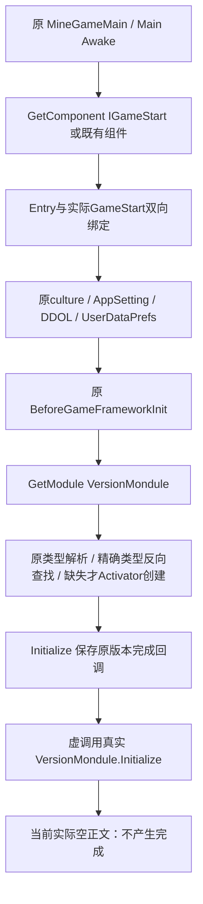

# 37 首场景入口第一批恢复

更新日期：2026-10-19。状态：**第 32 阶段的 32A 已实施到四个原入口文件，恢复 31 个原方法（含原静态构造）及 3 个字段初始化器。实际源码完整 GFRunning / Main 独立编译均为 0 错误，23 场景 / 71 检查通过。主流程 MainPlay4 已真实确认首场景抵达 VersionMondule 初始化空正文的完成门：原回调已保存，ready=false，框架未 Start，未进入原核心玩法。**

本报告记录实际实施与验证，不覆盖第 32 阶段的原只读计划；第 32 阶段的 104 项 native 审计是候选取证范围，不能计成 104 个恢复方法。

## 1. 四文件范围与原身份

| 实际修改文件 | 恢复方法 | 其他恢复 |
|---|---:|---|
| GFRunning/GameFramework/Base/GameStartEntry.cs | 12 | 原 isShowInitGameLog=true、tRJqx=3001、langLibrary=ZH_CN 三个字段初值 |
| GFRunning/GameFramework/GameFrameEntry.cs | 10 | 含原 `.cctor`，创建原 LinkedList 并恢复空菜单场景名和 false 标志 |
| GFRunning/GameFramework/Base/IGameStart.cs | 3 | 原双向绑定、LoadingUIShow、InitConfigOver 三个桥 |
| Assembly-CSharp/ljzs_lt/GameStart.cs | 6 | 原 OpenLoadingUI 迭代器重新由编译器生成，保留导出旧壳和 Token |

原字段、Token / RVA 标注、MonoBehaviour 组件身份和四份 `.meta` 都保留。静态构造原先遗漏，本批按真实 Token `0x060055DE`、RVA `0x715BAE8` 补回；这不是新增业务 API。原构造的三字段写入在 MonoBehaviour 基类构造前，按字段初始化器恢复，未猜测其他初值。

GameManager 第 29 阶段在主流程第 33 阶段时间生产者稳定后另行获准接回，已更新其自身报告与证据，不计入本批 31 方法。没有更改版本、资源、SDK、旧配置或任一其他代理拥有的业务源文件，也没有更改首场景、Fastmode 或原资源包。

## 2. 实际恢复的方法与原生依据

GameStartEntry 恢复 Awake、原日志包装、版本完成回调、资源 backend 完成回调、旧 Resources 完成回调、UI 完成回调、核心模块完成回调、LoadingUI 打开回调、旧配置资源回调、原内部配置完成桥、进入游戏前逻辑初始化、Update。

GameFrameEntry 恢复 Initialize、GetModule 泛型、原泛型类型解析、准确类型查找、Activator 创建与优先级插入、Start、ResourcesModuleUpdate、Update、LateUpdate、原静态构造。IGameStart 只恢复第 32 阶段确认的三个桥。GameStart 恢复 InitConfig、RegisterProcedure、InitPatchManager、OpenLoadingUI、RegisterLogicCtr、StartGame。

完整的 31 项 Token / RVA / native 字节数及四文件 SHA-256 在 `final-audit.json`。这些身份以原 DummyDll PE 元数据为准，泛型共享体再与原实例 MethodInfo 槽核对；没有将共享 GetModule<object> 当成游戏实际要求 object 模块。

本批复用第 32 阶段 104 项有界 ARM64，共 34,440 B；在本代理独立 launcher.i64 中补取 25 个原入口方法和 4 个必要短方法，复用主流程 6 项框架分发伪 C。所有 IDA 进程均自动结束，没有打开主流程的共享 framework.i64。关键类型解析、虚方法次序、字段偏移、分支和异常尾部仍以完整 ASM 核对，未机械复制伪 C 中错位的实参。

GameFrameEntry.Start 的原 `0x715B004` 跳入一个 8 字节 outlined 块：`0x856EAF8` 仅载入原静态类型指针，再跳回 `0x715B008`。这部分原字节也已保存，避免把伪 C 的 JUMPOUT 当成缺失整个正文。

## 3. 真实入口、模块缓存和 Initialize 契约



Awake 保留 Unity Object 的空比较和真实 GetComponent；缺少组件时调用原错误日志并返回，不能创建替代 GameStart。双向绑定使用原内部方法 Token `0x060071A8 / 0x72EAE70`；先写 AppSetting 的原 autosave / gameCode 接口，绑定后清配置完成位，再保留文化、collection 分支中的 AppName / 两个语言枚举、DontDestroyOnLoad、UserDataPrefs 和 Before 钩子的原顺序。

类型解析先检查 `typeof(T).FullName.StartsWith("GameFramework.")`，再按原 `{Namespace}.{Name}` 用 Type.GetType 解析。模块查找从 LinkedList.Last 向 Previous 比较准确 GetType，未找到才 Activator.CreateInstance；插入从列表前端遍历，按真实 Priority 降序，同优先级保持既有顺序。原错误类型和错误字符串保留，不扩展为可接受任意类型的缓存。

最关键的 Initialize 原正文是 **40 B**：检查模块非空 → 写本次 callback 到原 GameFrameModule `+0x18` → 用原参数数组虚调用模块 Initialize。它没有设置 `+0x10` 的 ready bool，也没有调用 callback。本批源码与实际 IL 完全保持该契约；callback 是本次替换保存，不是累加事件。

另以 Unicorn 执行这 40 B 原 ARM64：初始 ready=0、初始 ready=1、模块为 null 三个案例。前两项均在虚调用前观察到 callback 已保存、args 和 MethodInfo 原样传递，ready 原值不变；null 保持原空引用异常路径。外部模块虚方法由 hook 记录，不执行真实版本/网络服务。

## 4. 后续回调骨架与原始门禁

版本回调按原 UseNewRes 选择旧 AssetbundleModule 或 NewResLoadHelper 的实际 backend；新分支保留 IsKeWan、TeamType、正常 play mode 与原 Web 模式数值 4 的区分，按原位置记录参数。这里不执行原回调来“帮助推进”，不设置任何版本/资源完成位。

资源 backend 完成先调用实际 GameStart 的 AfterGameFrameworkInit，旧资源路径继续等待 ResourcesModule，之后才等待 UIModule；新路径直接等待 UIModule。After 使用原 managed-null 的可选调用，未引入 Unity 销毁对象比较的额外行为。

UI 完成按原顺序发起 Lang → Fsm → MineGameLogic → Time → Effect → ObjectPool 六项无回调初始化，最后 ProcedureManager 带原后继回调。原 native 没有逐个 await，不新增等待策略。核心模块完成后才执行框架 Start、原日志/SDK分支、GamePath、资源更新阶段位、语言配置、GF_InitFinish 和实际 InitPatchManager。

本批对第 32 阶段概述有两项明确的原生纠正，原计划文件保持原样：

- **GameFrameEntry.Start 没有“已经 started 就 return”的前置门。**完整 ASM 加 outlined 块表明它每次都设置文化并逐个调用模块 Start，成功遍历后才写 started=true。候选保留重复调用的原行为；若中途异常，不能抢先写 true。
- **RegisterLogicCtr 的实际次序是 ServerTimeMgr → PurchaseControl → EmailControl。**第 32 阶段文字概述次序不准确，本批按原 `0x439BEE4` 的真实调用次序恢复。

LoadingUI 协程先输出原 `OpenLoadingUI` 日志，yield 装箱 int 0 一帧，之后才调用 LoadingUIShow。IGameStart 桥到原 LoadingUI 打开回调，保留原 SDK 游戏开始接口位置；旧资源仍请求 `data/config`，返回真实 ResourcesInfo 后调用实际 ConfigMgr.SetConfigABRes → ConfigMgr.Initialize → InitConfigOver。配置完成桥调用原 Entry 内部 helper，只有这条原完成路径才写自身配置标志并进入原逻辑初始化。

原进入游戏前逻辑次序为 SetLayerCollisionMatrix → MnieGameProjectSetting → RegisterProcedure → RegisterLogicCtr → Audio 初始化 → InitCtrl(!m_Fastmode) → 原本类逻辑/资源阶段位 → CommonSettings → 原 SDK StartMineGame → ExitGame 监听 → 实际 GameStart.StartGame。后者保持 ProcedureManager.StartProcedure<ProcedurePreLoad>，注册的原流程为 PreLoad、StarGame、ExitGame，未替换为新流程或简化棋盘。

原 SDK 接口调用位没有删除或用成功标志替代；本批编译和夹具不会联系服务，主流程 MainPlay3/4 也停在其之前的版本门。实际 SDK 能力、CommonSettings 和版本/资源契约仍属于后继恢复，不把空 SDK 实现描述成已服务成功。

## 5. 当前停点：原运行已确认，非仅静态推断

主流程 MainPlay3 已运行原场景 30 秒、15 次快照、0 errors，Main 进入 DontDestroyOnLoad，原场景持续更新，未切入核心玩法。随后 MainPlay4 使用只读静态模块观察：仅读取已存在的原 LinkedList 和继承字段，不调用 GetModule、不执行属性 getter、不创建模块，也不写 gate。

`work/recovery-ledger/unity-play-main4.json` 的全部 15 次快照（frame 1 至 130135）一致：

| 实际观察项 | 当前值 |
|---|---|
| 原缓存模块 | 唯一 `GameFramework.VersionMondule` |
| 模块原 ready `GameFrameModule.x_0080_008D_00B1f_0086` | false |
| 原 callback 字段 | `delegate:GameFramework.Base.GameStartEntry.vj_00B7_0098_008A_007F` |
| persistentABRes / streamingABRes / CurrBundleServices | 全部 null |
| GameFrameEntry 原 started 字段 | false |
| Entry 配置完成 / 逻辑阶段位 / 资源更新阶段位 | 全部 false |
| m_Fastmode / m_AutoSaveData | 原场景 false |
| 原场景 | 始终 MineGameMain |
| 错误 / 核心玩法接受 | 0 / false |

原 VersionMondule.Initialize，Token `0x060060DB`、RVA `0x71EB634`，当前源码仍为导出空正文；InitForNewRes 和 Init coroutine 生产链也未在本批恢复。因此目前最短的真实依赖链是：

`Awake → 实际绑定 → BeforeGameFrameworkInit → GetModule<VersionMondule> → Initialize 保存原 callback → 空 VersionMondule.Initialize → 无完成回调`。

这已经由运行中的既有模块及回调字段确认，不再仅依据“没有报错”推论。AppSetting 文化/属性和 UserDataPrefs.OnInit 在当前源码仍不完整，但同步返回，不是更早的回调等待点。GameStart 未重写 BeforeGameFrameworkInit，继承 IGameStart 默认空虚方法；该默认方法的原 native 本来就是 RET，不能误报成早于版本的缺失工作。

CommonSettings 在配置完成后的逻辑初始化中，GameFrameEntry.Start 在 Procedure 模块完成回调中，都位于版本之后。它们确有未恢复依赖，但不是此次实际首停点。本批没有通过手动回调、开 Fastmode、创建空配置、SDK 登录或写 Data/ready 标志推进该状态。

## 6. 验证层次与结果

| 验证 | 结果 | 实际可证明的范围 |
|---|---|---|
| 完整 GFRunning 候选及实际源码，用 Unity 原 csc/rsp | **均 exit 0 / 0 errors** | 三个框架源与现有框架声明、内部字段/虚方法匹配 |
| 完整 Main 候选及实际源码，引用本批实际 GF 编译输出 | **均 exit 0 / 0 errors** | 实际 GameStart 和同批框架可共同编译，未使用旧 Dummy DLL充当实现 |
| 实际四源直接 Compile Include 的控制流依赖适配夹具 | **23 场景 / 71 检查 / 0 失败** | 双向绑定、早期失败、原参数/回调门、类型缓存与优先级、重复 Start、old/new/Web 分支、模块顺序、原 yield、配置异常和原 PreLoad/控制器调用次序 |
| 原空壳负对照 | **23 场景全部失败 / 15 检查完成** | 能发现丢失初始化、分发、回调桥和原字段默认值 |
| 原 Initialize ARM64 执行 | **3 案例通过** | 原 callback 写入/args 虚调用/ready 不变/null 异常 |
| 实际编译类型 IL 读回 | **13 项通过** | 原 Version 泛型实例、绑定顺序、dispatcher 无伪 ready、原类型与 Activator、Start 末尾标志、原 cctor、配置完成次序、控制器次序、PreLoad 与新编译迭代器 |
| 原方法身份 / 源码窄读回 | **31 项身份匹配，4 meta 不变** | 仅声明的正文、原 cctor和3字段初值；原Token顺序保留，原静态构造 Token补回 |
| 主流程真实 MainPlay3 / MainPlay4 | **各30秒 / 各15快照 / 各0 errors** | 原场景已运行；MainPlay4准确停在版本完成门 |
| 原版本解析、资源实际消费、旧配置、Procedure/地图/开格/战斗、视觉与手工玩法验收 | **未通过 / 尚未执行到** | 不把源码、夹具或无错误日志当成玩法完成 |

完整程序集编译沿用 Unity 生成 rsp 的源文件和引用，只把输出、生成器输出移入 work；候选阶段仅替换四个候选输入，实际阶段直接读取生产源。所有检查 DLL 留在 work，未安装或覆盖 Unity Library/Assets 二进制。

控制流夹具使用实际四文件和原 GameFrameModule 声明，Unity、SDK、ConfigMgr 及其他模块为可控依赖适配器。它能验证调用与错误边界，不能证明真实依赖实现。测试显式释放 Version/backend/UI/Procedure 的可控回调，是 work 内的单元边界验证，不在工程中假造完成。源码测试没有触发网络、真实 SDK 或遥测。

## 7. 明确未恢复和后继最小范围

下一步先闭合 **VersionMondule.Initialize → 原 InitForNewRes / Init 协程 → UpdateManager 宿主 → 本包实际版本/ABFiles/资源服务输入 → 原版本完成回调**。版本状态必须由真实输入解析与服务结果产生，hash 审计或文件存在不能替代消费完成。

后继仍包括 AppSetting 原字段属性/静态默认值与文化、UserDataPrefs 持久化、旧 Assetbundle manifest 或实际新资源 backend、Resources/UIModule 完成契约、六个次级模块加 ProcedureManager 的真实 Initialize/Start、旧 ConfigMgr 的实例/数据/表解析、Fsm/控制器消费者、SDK/平台/CommonSettings。新资源配置分支 `0x72E6B44`、原 collection helper、退出/应用生命周期及混淆替代回调仍为空壳，本批未冒称闭合。GetAllModule、HaveModule、Shutdown 等未用的框架功能也未纳入本批恢复数。

当前原 before/after 默认虚方法、部分项目设置空方法在 native 本来只有 RET，不给它们编造业务；现有原 `GameStart`/IGameStart 构造隐式基类调用不重复计为恢复。当前唯一已实际到达的完成断点是版本模块，后面还存在多个未被执行到的真实依赖，不能称“只差版本一处就能玩”。

## 8. 复现、哈希与归档

```powershell
& work/stage37-entry/compile-candidate.ps1 -Actual
dotnet run --project work/stage37-entry/tests/EntryTests.csproj -c Release -p:Actual=true
& 'C:/Users/luxinyu/AppData/Local/Programs/idapromcp/source/.venv/Scripts/python.exe' work/stage37-entry/emulate_initialize.py
& 'C:/Users/luxinyu/AppData/Local/Programs/idapromcp/source/.venv/Scripts/python.exe' work/stage37-entry/audit.py
```

四份实际恢复源 SHA-256：

| 文件 | SHA-256 |
|---|---|
| GameStartEntry.cs | `af9fbe54aa67774c2925bbdc322c2fdda3c9bc1f7f1b3be7705e1135dda163a4` |
| GameFrameEntry.cs | `f05bc11968d5cdae3dfc5a0c94f082c7fb213e4fb0e24744f310ed611d7b8a17` |
| IGameStart.cs | `07dbbd9852c888dc17142c89fece1ca7342fd3fa35f6c9f0b84a569f090a9f67` |
| GameStart.cs | `ac2a24a5964d3896debfc30f4e45f0ff78044eac12b3f4d7576675e6b4b16b23` |

原前态与后态、四 meta、31 身份、窄 diff、原 104 方法审计索引、补充 IDA/ASM、Start outlined block、原分发器执行、候选/实际编译与日志、类型 IL、实际夹具/负对照、主流程 MainPlay3/4 观察副本和 final-audit.json 归档至 `证据/首场景入口第一批恢复/`。不包含实验 DLL 或大型 IDA 数据库；原第 32 阶段只读报告与计划未覆写。
