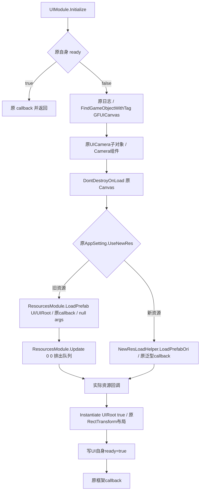

# 40 UIModule 原始启动恢复

更新日期：2026-10-19。状态：**UIModule.cs 单文件已恢复 12 个原方法语义、5 个实例字段初始化器和原静态构造的 4 项字段写入。实际完整 GFRunning 编译 0 错误；实际源码控制流夹具 23 场景 / 53 检查通过，原空壳负对照 23 场景全部失败。**本阶段没有启动、关闭或另开 Unity；主流程使用用户当前 GUI 实例完成后继运行观察。

当前尚未声称 UI 已显示、原游戏已进入或核心玩法通过。第 37 阶段 MainPlay4 的真实首停点仍是 VersionMondule；UI 启动后还必须消费第 39 阶段的真实资源加载与实例化结果。

## 1. 范围、Token 与字段初始化

唯一 UI 业务文件为 `Assets/Scripts/GFRunning/GameFramework/UIModule.cs`。原字段、方法 Token / RVA、接口、导出嵌套壳及 meta 均保留。Fsm/ProcedureManager、GameStartEntry/IGameStart/GameStart、AppSetting 和资源代理拥有的文件均未混入本 UI 修改。

| 恢复内容 | 原 Token / RVA | 说明 |
|---|---|---|
| Priority | `0x06005F47 / 0x71D7550` | 两指令原常量 40，影响真实模块优先级 |
| Initialize | `0x06005F48 / 0x71D7558` | 原场景 Canvas/Camera、old/new 资源分支及后继回调 |
| LoadUIRootOver<T> | `0x06005F49 / 0x507AE88` 泛型共享体 | 原接口实例化、真实 RectTransform 布局和自身完成状态 |
| wait2Fram factory | `0x06005F50 / 0x71D7FD4` | 使用保留的原嵌套状态机，不新造等待逻辑 |
| _GetUINode | `0x06005F51 / 0x71D805C` | 原查找缓存与缺失时 Canvas 回退 |
| UIModule 构造语义 | `0x06005F63 / 0x71D8D5C` | 原 5 项分配在基类构造前，以字段初始化器恢复 |
| 原静态构造 | `0x06005F64 / 0x71D8EA4` | 原导出源遗漏，按原 metadata 补回 |
| wait 状态机构造 / MoveNext / 两 Current / Reset | `0x06005F73, 75, 76, 78, 77` | 保留原状态和接口方法身份；Dispose 的原正文只有 RET，已有空实现保持不变，不计为新增恢复 |

5 个实例字段初值依次是 Dictionary<string,Transform>、WaitForEndOfFrame、WaitForSeconds(0.5f)、WaitForSeconds(0.3f)、Dictionary<string,BaseUI>。静态构造依次写 UIScaleInTime=0.5f、UIFadeOutTime=0.3f、UIScaleOutTime=0.2f，再创建原 openUIStack List<BaseUI>。前两个 float 位来自原 ELF `0x1838D10` 的 `0000003f9a99993e`，第三个来自原立即数 `0x3E4CCCCD`；没有根据字段名字猜测数值。

原 Cpp2IL 元数据再次确认 `.cctor` Token `0x06005F64` 及 RVA；其他原 Token 顺序保留。完整读回逆转本批正文/初值/原 cctor 后与源前态一致，仅允许新增静态构造带来的空行差异；其他 UIAnim 壳、未知 UI API 和其已有状态都保留。

## 2. 原 Initialize 的场景与资源链



原 Canvas tag 是 `GFUICanvas`，原子对象路径是 `UICamera`，资源地址为 `UI/UIRoot`。不查找临时画布，不创建替代 Camera 或 UIRoot。旧资源请求后原 native 立即再取 ResourcesModule 并调用 Update(0f,0f)，本批完整保留；资源代理沿原队列提供实际 typed ResourcesInfo。新资源路径保留 AssetOperationHandle 泛型回调及原空 object[]。

几个容易被“修顺”的原行为保持：Canvas 缺失时记录原错误；Canvas 存在而 UICamera 子节点缺失时，原 Transform.Find 的结果会在 `.gameObject` 处失败，不能跳过。若 UICamera GameObject 存在但没有 Camera 组件，原代码允许 UICamera 字段为 null 并继续请求 UIRoot，本批不增加一个原来没有的完成门。上述边界在夹具中分别验证；实际场景/资源仍应由主流程核实。

## 3. 真实 UIRoot 实例化、布局和完成顺序

原接口调用不是 Instantiate(bool) 重载，而是 `IResCallBackInfo.Instantiate("UIRoot", true)`。原 ASM `0x507AF60` 写 W2=1，接口 slot 4 和原字符串共同确认。资源代理随后从原 `ResourcesInfo.Instantiate` native 核实 bool 表示克隆激活，未解释成 DontDestroy 或凭空生成 UI。UIModule 保留这两个原实参；资源加载/克隆职责仍属于资源代理。

实际返回对象必须提供 RectTransform。随后按原次序 SetParent(canvas.transform)、localScale=Vector3.one、anchorMin=zero、anchorMax=one、offsetMin=zero、offsetMax=zero。SetParent 使用原单 parent 参数重载，不改成另一个 worldPositionStays 契约。

原特殊布局条件为 `AppSetting.IsPortrait && CanvasScaler.matchWidthOrHeight == 1f && AppSetting.isHeightCtrWidthFixedWidth`。仅 Canvas RectTransform.sizeDelta.x 大于 720f 时，按 float32 `(width-720f)*0.5f` 设置对称横向 offset；没有按 Editor 分辨率设计新适配，也没有修改 AppSetting 源。

只有上述实例化、组件、父子关系和布局调用全部完成，原方法才写本模块继承的 ready=true，然后调用当前保存的原 callback。实例化或布局失败就不写 ready、不回调；callback 自己抛异常时，原 ready 已经为 true，不增加回滚。再次 Initialize 时保留原已完成即回调并返回的行为。

## 4. wait2Fram 的确切行为及启动边界

原 wait2Fram 的状态为：state 0 → current=null / state=1 / true；下一次 → current=null / state=2 / true；第三次先置 state=-1，再可选调用 action，返回 false。Reset 抛 NotSupportedException；Dispose 原本为空，不会自行终止后续 MoveNext。两个 Current 接口返回原 current 字段。

这条状态机采用保留原嵌套类的实际构造、MoveNext、Current 和 Reset，不在 work 夹具里另写一套状态机。原 Initialize/LoadUIRootOver 启动链**没有调用 wait2Fram**，本批没有把“两帧等待”插进 UI ready 前后，也没有用延迟掩盖资源尚未完成。

原 ARM64 MoveNext 的 112 B 已直接在 Unicorn 执行：有 action / 无 action 两个案例，各连续 4 次 MoveNext，返回值 `[true,true,false,false]`，state `[1,2,-1,-1]`，current 均 null；action 只在第三步调用一次且调用前 state 已为 -1。delegate 的外部执行仅用 hook 记录，不执行真实业务。

原宽度比较指令另直接执行 719、720、721、负无穷、正无穷、NaN 共 6 个值，确认分支等价于源码 `width>720f`；NaN 不进入裁边，未将伪 C 的比较写法误用于无序浮点分支。

## 5. 验证与实际限制

| 层次 | 结果 | 可证明范围 |
|---|---|---|
| 实际完整 GFRunning，Unity 原 csc / rsp，仅输出在 work | **exit 0 / 0 errors** | 单文件与当前真实框架/Unity UI/API签名共同可编译 |
| 实际源码直接 Compile Include 的依赖适配夹具 | **23 场景 / 53 检查 / 0 失败** | 原场景引用、资源回调门、RectTransform顺序、宽度条件、失败/异常、缓存和原状态机 |
| 原空壳负对照 | **23 场景全部失败 / 9 检查完成** | 能识别遗漏构造、原分发和迭代器，而非只跑空方法 |
| 原 ARM64 | **wait 2案例×4步、width 6值全部通过** | 原状态机/浮点分支，不把 hooks 当成 Unity 资源实现 |
| IDA 边界 / 原完整 ASM | **11 项精确起止匹配，另有Priority/cctor原字节** | 原方法身份与正文边界 |
| 原 metadata | **UI及嵌套7类型只读取证** | cctor、状态机、原字段/方法Token及签名 |
| 实际类型 IL | **12 项通过** | 实例分配在base前、原priority/路径、接口Instantiate、layout→ready→callback、原状态机与cctor字段写入 |
| 源码窄读回 | **实际源逐字节等于候选，原meta未变** | 本批范围明确；未覆盖其他代理文件 |
| 本阶段 Unity 场景/视觉/UI交互验收 | **not-run** | 主流程会在真实资源闭包后使用用户GUI实例统一观察 |

夹具中的 Unity、资源加载及接口产物为可控依赖模型，验证的是实际源码何时调用、写状态、等待和失败；不能证明原 prefab/材质/Canvas 的实际可见性。当前完整原场景的最近确认仍是第 37 阶段版本门，不能把本报告的 UI 源码恢复写成 UI 运行通过。

其他 UIModule 的 Open/Show/Close/Refresh/动画和 UIList/Canvas/Loading/OpenUIStack 等未知 API 保持原有导出状态，未算入恢复；原 UIAnim 壳未借此改写。后继消费者仍需逐段恢复，这不是完整 UI 框架验收。

## 6. 哈希、协作交接与复现

- UIModule 实际恢复源：`0103669938ab5f4f4510b3b8cf25456dcf917f1f0edf084c4225bd9be847d083`。
- 源前态：`2369088364ec333b14c9a23f6b79c7794a60e79b0cd7bae092194bccf8593812`。
- 原及当前 meta：`682342446077e06b3babffaf5cc5841f4702f22f59e434a4a9285692692f88cb`。

并行窗口交接为 `work/parallel-coordination/stage40-handoff.json`。源已冻结，只由主流程安排 GUI Unity 验证；本代理未开关 Unity。

```powershell
& work/stage40-ui/compile.ps1 -Actual
dotnet run --project work/stage40-ui/tests/UITests.csproj -c Release -p:Actual=true
& 'C:/Users/luxinyu/AppData/Local/Programs/idapromcp/source/.venv/Scripts/python.exe' work/stage40-ui/emulate_wait_and_width.py
& 'C:/Users/luxinyu/AppData/Local/Programs/idapromcp/source/.venv/Scripts/python.exe' work/stage40-ui/audit.py
```

源码前后态/meta、窄 diff、原 native及补充状态、原 metadata、构造/静态常量、原生 oracle、候选/实际编译日志、类型 IL、实际夹具/负对照和 final-audit.json 归档至 `证据/UIModule启动恢复/`，不包含实验 DLL 或大型 IDA 数据库。

## 7. 获批的资源依赖窄扩展

主流程在 UI 源稳定后另行授权本代理独占 `Resources/BundleAssetInfo.cs`：仅两原构造和有逐项 ARM64/字段偏移证据的字段 getter/setter，保持 meta。该类的真实 BundleName / LocalPath 决定 firstpack 服务分支，不能继续返回空值，也不能由 provider 给假空值跳过真实内容。

本扩展不修改 VersionMondule、UpdateManager、PatchManifest、ResourcesModule、ResourcesInfo 或平台 provider。**BundleAssetInfo.cs 已独立窄写回并验证：2 个原构造、52 个原 8 字节字段访问器，以及原 inApp=true 字段初始化。**52 项均只有真实 LDR/STR+RET，以原字段 offset 逐项映射；保留原混淆别名和 property/private helper 桥，没有重命名或新增一个替代数据类型。

原完整构造 Token `0x0600725F / 0x72EB0D0` 的字段顺序与实参保持：LocalPath、RemoteURL、Version、IsEncrypAB、BundleName、ObfuscatorName、RandomSeed、inApp。原 inApp 字段先在 Object 基类构造前初始化 true，再由完整构造的第八个参数覆盖，默认参数仍为 true。原详细日志门、AssetBundlesDetailed tag（0x1000000）、八项格式和调用位置均保留；没有因“只是记录信息”删去原门。

原短构造 Token `0x06007272 / 0x72EB4AC` 保留真实 BundleName 与 LocalPath，Version=0，RemoteURL=string.Empty，其他可选字符串仍为 null、IsEncrypAB=false、inApp=true。缺少本地路径时也不会把真实 BundleName 改成空值；值对象不负责将路径补成可用状态，不调用完成回调，不做 SDK/下载/登录/Data 操作。provider 必须自己证明实际资源能力，不能借此构造一个假可用记录。

| 扩展验证 | 结果 | 范围 |
|---|---|---|
| 实际完整 GFRunning 原 csc/rsp 编译 | **exit 0 / 0 errors** | 与第39阶段真实接口及其它当前框架共同可编译 |
| 实际单文件源码消费夹具 | **6 场景 / 24 检查 / 0 失败** | 完整/本地/缺失路径记录、null与大小写、带符号版本、真实property私有setter桥、原日志门/格式 |
| 原空壳负对照 | **6 场景全部失败 / 8 检查完成** | 能发现空构造和空属性 |
| 52 原标量方法直接 ARM64 执行 | **156 / 156 输入通过** | 每项3组pointer/int边界原字段读写 |
| 两原构造直接 ARM64 执行 | **4 / 4 案例通过** | 全部字段 offset/参数、short的原空远端、inApp默认与覆盖、基类构造前初值 |
| 原 native 范围与窄源读回 | **54 方法 / 1,388 B；Token/meta保留；actual==candidate** | 无同文件以外业务编辑 |
| 真实 bundle/manifest/typed资源加载 | **本扩展未运行** | 第39阶段provider和主流程GUI验收另行记录 |

原构造执行只对 System.Object 构造设置外部 hook、关闭原日志开关，并以不同指针字验证字段身份；不把该原生模型描述成真实 bundle/Unity asset 已加载。扩展完整源码没有 Unity 实例化职责，测试没有联网。

扩展实际源 SHA-256 为 `67f6842b7585e4cbc78b88311b72cfd9018f205b29f84cbaeb10e5c1e4dce585`；原/现 meta 均为 `92153b6e5d61fc63d568d4df27256f548c97142531954e0f8fe4ff99f05bf507`。扩展独立交接 `work/parallel-coordination/stage39-bundleassetinfo-handoff.json`，证据目录 `证据/BundleAssetInfo资源值对象/`，不把 UI 的 23/53 数字用于这个值对象。
