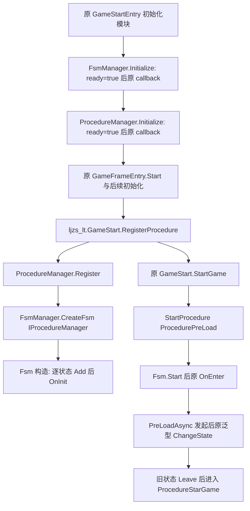

# 42｜原流程状态机与 Procedure 恢复候选

Stage42 已交付可供主窗口集成的六份候选，核对了原 82 个成员契约（其中 8 个原方法本来就是 RET），实际候选独立编译成功、52/52 项 CLR 检查通过，原 ARM64 oracle 43/43 项通过。**候选尚未应用共享工程，原地图、开格与兵堆战斗运行目标尚未通过。**

还有一个已实证的生产阻塞：范围外 `Utility.Text.GetFullName` 仍返回 null。直接加载本轮完整 GFRunning 编译产物，使用其中的真实 Utility 和 FsmManager，创建 FSM 实际抛 `ArgumentNullException(key)`。主窗口必须恢复原键生成 helper，才可期待原 Register → StartProcedure 在 Unity 中继续执行。生命周期夹具的 Utility 边界和这一真实生产负对照分别保存，不能混为同一个验证层级。

## 分工与原始输入

实际工程根 `C:\Users\luxinyu\Documents\Codex\2026-10-19\x20`；工作目录 `C:\Users\luxinyu\Documents\Codex\2026-10-19\x20\work\parallel-42-fsm`。初始九份范围内源码逐字节保存到 `source-before/`，`owned-scope.json` 记录开始 SHA、原 Token/RVA/签名和原有全部非空叶正文（54 项，包含 return null/default 的占位正文）。只有六份源码产生候选；原接口、delegate、字段身份、Token、Address、FieldOffset 字面量与全部 .meta/GUID 保持，三个无需改动的文件也纳入应用前哈希检查。

使用专属 `ida/framework.i64`，未操作共享数据库。原 ARM64 实读 SHA256 为 `72770d00b2b404acf44cc75cc8bf7a3e06850e9ace1237c9cbb2bc72894220ed`，与任务基线一致；本轮 native oracle 直接读取 ELF 的 PT_LOAD 地址映射。APK路径与哈希沿用任务指定基线，本轮没有重新计算 APK 哈希。DummyDLL/声明只用于形状和元数据核对，没有拿声明中的空方法当原实现。

## 最小原调用闭包



当前 `ljzs_lt.GameStart.RegisterProcedure` 明确创建 PreLoad、StarGame、ExitGame 三个原实例，`StartGame` 调用原 `StartProcedure<ProcedurePreLoad>()`。本轮没有改这些业务文件，没有直接调用业务 Procedure 去代替状态机。第20篇的 PreLoadAsync 发起后立即切状态顺序保持。

`ProcedureManager.Initialize` 原生不取 FsmManager、不 Register、不 Enter；只是设置继承完成字段后同步调用已经保存的回调。真正获取 FsmManager 并创建 `Fsm<IProcedureManager>` 的地方是 Register。ProcedureManager.Start 和 Update 原来均为单条 RET，不能给它额外添加状态更新，否则会和 FsmManager 重复。

## 六份候选与成员对应

| 候选文件 | 原成员契约数 |
| --- | ---: |
| Fsm.cs | 26 |
| FsmBase.cs | 5 |
| FsmManager.cs | 17 |
| FsmState.cs | 12 |
| ProcedureBase.cs | 6 |
| ProcedureManager.cs | 16 |

逐成员 Token、RVA、精确 end、原签名和重新读取的候选正文 SHA 位于 [method-restoration.json](证据/Stage42原流程/method-restoration.json)。82 项包括 74 个非 RET 契约及 8 项确认本来为空的默认生命周期/模块方法，没有把接口声明新增计数。

FsmBase 的默认构造原本跳入有名构造并传 null；候选使用 `: this(null)`，有名构造把 null 名称保存为空串。Fsm 构造使用原 `base(name)`，先校验 owner 与 states，再创建两个字典，按照输入顺序执行每个状态的“校验、按 FullName 查重、Add、OnInit”；最后才重置 current/time/destroyed。因此 OnInit 中立即启动或重入后，构造结尾仍会清 current/time，不能悄悄改成一个更常见的生命周期。

独立复核发现并修正了一处原构造顺序：FsmManager 的 `m_deleteFsm` 原来在调用 GameFrameModule 构造前分配。最终候选将这次分配写回字段初始化器，构造正文只依次创建 m_Fsms、m_TempFsms；修正后重新运行52项CLR、完整独立csc与真实生产依赖探针。最终独立review也逐 Token 对照原dump和泛型native映射，82项零错配，详细记录在 `research-procedure/fsm-independent-review.json`。

泛型实现采用原引用类型共享 native：`Fsm<object>`、`FsmState<object>` 与 manager 泛型 `<object>`。实际 Procedure 特化由原 `ScriptMetadataMethod` 中的 `FsmState<IProcedureManager>.ChangeState<ProcedureStarGame/ProcedureExitGame>`、`IFsmManager.CreateFsm/DestroyFsm<IProcedureManager>` 确认，记录在 `exact-generic-instantiations.json`。这些方法都是 instance ABI，末尾 MethodInfo；业务参数为引用、float 或 bool/int，不存在公开边界结构体传值。Update 的两个 float 在 S0/S1，候选保留两个不同 delta 参数。

原 native 给出 Fsm 实际实例字段偏移：Owner=0x20、States=0x28、Datas=0x30、Current=0x38、Time=0x40、Destroyed=0x44。泛型 DummyDLL 的 FieldOffset=0 声明没有拿来当这些字段在原 ARM64 中的实际位置。Type.FullName 在原 dump.cs 第312155–312156行为 Slot29，vtable `0x138+29*0x10=0x308`；原状态键、CurrentStateName 与 Procedure 日志均读取此 slot。

## 生命周期、异常和重入

- Start 在 IsRunning 时抛原异常；否则查状态、先写 current/time，再进入。args 为 null 或长度0调用无参 OnEnter；非空数组调用带 args 重载并保留原数组身份。FsmState 两个默认 OnEnter 分别是 RET，不互相转发。
- ChangeState 必须已有 current，目标不存在时不 Leave、不重置时间；正常顺序为旧 OnLeave(false) → time=0 → current=目标 → 新 OnEnter。切到当前相同状态也完整 Leave/Enter。
- Leave 抛异常时保持旧 current 和原 time；Enter 抛异常时保留已经赋值的新 current 与零 time。进入回调内重入会同步完成嵌套切换；退出回调内重入后，外层仍继续赋原目标。没有增加重入锁或队列。
- Update 仅在 current 非空时累加 elapseSeconds 的 float32 值，然后传两个原 delta 给 OnUpdate；不会用 realElapseSeconds 代替累计时间，也不会额外根据 IsDestroyed 短路。
- Shutdown 先 Leave(true)，然后清 current/time，再按字典迭代销毁所有状态、清状态和数据、最后标 Destroyed。若原 current 已空则不额外清 time；Leave 或 Destroy 抛异常时保留原执行到该点的状态。ProcedureShutdown 只有 Destroy 成功后才清 FSM/manager/ready。
- manager 保留动态索引 for 循环，且销毁立刻移除 List 项。当前项自删会跳过右移来的下一项，回调中新建的项可在同一轮被访问。这些是原生执行得到的行为，没有换成快照或延迟删除。
- 事件只向 current 状态分发；订阅组合 delegate，退订保留可能为 null 的键；默认 OnDestroy 清 handler 字典。数据方法保留空名称异常、允许 null value、泛型显式类型转换及 TryGetValue 不存在返回 null 的行为。

## 反编译失败如何核实

82项全部实际 start/end 与 metadata 对齐，不能用 IDA 把相邻方法合并后的伪代码推断。共有14项伪C含 JUMPOUT；逐一检查精确 ASM 后确认正常路径提前返回或尾转，末尾异常路径调用 noreturn raise helper `0x3C3D3A0`。反编译器把它当可能返回，才显示跨向下一独立方法。全部本地分支都落在已核定方法内，没有留下需要遗漏恢复的 outlined 业务岛。

GetProceduresType 的尾部还核对了显式 castclass，失败调用 `0x3C3D868`；没有改成 as 后访问 Length。详细逐项位置与末指令见 [JUMPOUT审计](证据/Stage42原流程/jumpout-review.json)。原方法本来为 RET 的8项仅保留空默认行为并加来源注释，不能把这些解释成“用空回调推进”。

## 验证与负对照

| 层级 | 实际结果 | 能证明的范围 |
| --- | --- | --- |
| 原空方法负对照 | 52/52失败，0通过；夹具编译成功 | 测试确实能检出缺失的 FSM/Procedure 行为 |
| 实际候选 CLR | 52/52通过 | 六份候选正文原样编译后的生命周期、调用顺序、异常、重入、事件/数据、动态列表和 Procedure 桥 |
| 原 ARM64 oracle | 43/43通过 | 原 ELF 指令在 Unicorn 2.1.4 下的构造、状态、计时、销毁和 manager循环路径 |
| GFRunning 独立 csc | exit0/errors0 | 原 Unity rsp 引用、define、语言设定与全部 analyzer/source generator下，替换六候选可编译 |
| 无适配生产负对照 | actual helper=null；actual CreateFsm抛ArgumentNullException(key) | 范围外原键 helper 未恢复时，真实完整程序集仍无法注册FSM |
| 应用脚本检查 | 全部通过 | 原SHA匹配的独立副本可写入；任意源变更在第一笔写入前拒绝，哨兵及其他文件均不变；真实工程只读预检通过 |
| Unity/图形/交互 | 本轮未运行 | 由主窗口集成并观察原场景，不能用上述验证替代 |

CLR fixture逐字节复制候选后再编译，source-provenance和harness-provenance保存哈希，没有手写第二份 FSM 算法。Utility、GameFrameEntry 和 CLog 是显式控制的测试边界。用于验证真实 null-key 问题的独立生产探针则直接引用完整 `GFRunning.Stage42.dll`，没有 BoundaryAdapters。原生 oracle 执行实际 ELF 的业务指令，字典、分配器、metadata、虚调用等 IL2CPP运行时边界使用hooks；CallbackAbort只是在hook停止后的状态观测，不声称原 C++ 异常展开已验证。CLR异常传播有单独用例。

复现命令（PowerShell，不启动 Unity）：

```powershell
pwsh -NoProfile -File 'C:\Users\luxinyu\Documents\Codex\2026-10-19\x20\work\parallel-42-fsm\validation-research\run-validation.ps1' -Mode baseline
pwsh -NoProfile -File 'C:\Users\luxinyu\Documents\Codex\2026-10-19\x20\work\parallel-42-fsm\validation-research\run-validation.ps1' -Mode candidate
pwsh -NoProfile -File 'C:\Users\luxinyu\Documents\Codex\2026-10-19\x20\work\parallel-42-fsm\validation-research\compile-candidate.ps1'
pwsh -NoProfile -File 'C:\Users\luxinyu\Documents\Codex\2026-10-19\x20\work\parallel-42-fsm\validation-research\run-production-dependency-probe.ps1'
& 'C:\Users\luxinyu\AppData\Local\Programs\idapromcp\source\.venv\Scripts\python.exe' -X utf8 'C:\Users\luxinyu\Documents\Codex\2026-10-19\x20\work\parallel-42-fsm\native-oracle\native_oracle.py'
& 'C:\Users\luxinyu\AppData\Local\Programs\idapromcp\source\.venv\Scripts\python.exe' -X utf8 'C:\Users\luxinyu\Documents\Codex\2026-10-19\x20\work\parallel-42-fsm\verify-package.py'
```

初版36项红绿结果保留在 work 的 results-v1-36.json；补足未注册8API、析构异常、两OnEnter独立行为、构造重入及foreign IFsm类型转换后，最终52项红绿如上。没有通过改测试预期掩盖原空方法。

## 主窗口集成与剩余依赖

应用脚本 `C:\Users\luxinyu\Documents\Codex\2026-10-19\x20\work\parallel-42-fsm\apply-candidate.ps1` 默认只预检，主窗口在完成审核后用 `-Apply`。它先验证全部九源开始SHA、九个meta SHA和六候选SHA，然后每文件写入前再核源SHA，写后再核候选SHA。任一开始SHA不符会拒绝整批，不会覆盖其他窗口已改的源。若应用过程发生I/O故障会抛错并保留实际已写状态供主窗口处理；本脚本不宣称跨六文件写入是操作系统事务。

```powershell
pwsh -NoProfile -File 'C:\Users\luxinyu\Documents\Codex\2026-10-19\x20\work\parallel-42-fsm\apply-candidate.ps1'
pwsh -NoProfile -File 'C:\Users\luxinyu\Documents\Codex\2026-10-19\x20\work\parallel-42-fsm\apply-candidate.ps1' -Apply
```

需要主窗口处理的范围外依赖详见 [integration-dependencies.json](证据/Stage42原流程/integration-dependencies.json)：第一优先是 GetFullName 两个原 helper；GameFrameworkException(string) 还未转发异常消息，CLog.LogProcedure 未显示日志，ProcedureTypeAttribute构造影响私有反射路径。这些不在本轮授权候选范围，所以只交证据和清单，未写其源码。当前第5轮真实场景的 CoreBlit 两条渲染错误仍按原 ledger 保留，不能由本轮状态机验证解释为已修复。

最终交接 `C:\Users\luxinyu\Documents\Codex\2026-10-19\x20\work\parallel-coordination\stage42-handoff.json`，state=`ready_for_integration`，明确 `integration_blockers` 与 `runtime_acceptance=false`。本窗口线程ID为 `01a15371-a51b-7243-ba1c-29be968f5006`。最终证据时间：2026-10-19T17:31:19+08:00。


## 主线程实际集成检查点

主线程已按SHA门实际合入六个候选，共82原方法，必要Utility.Text两原方法已接入。完整GF编译通过；Main6仍未抵达原流程执行。 详见[第10篇最新运行结果](10-Unity运行验收.md)。用户已要求暂停后上传，源码本批冻结。
