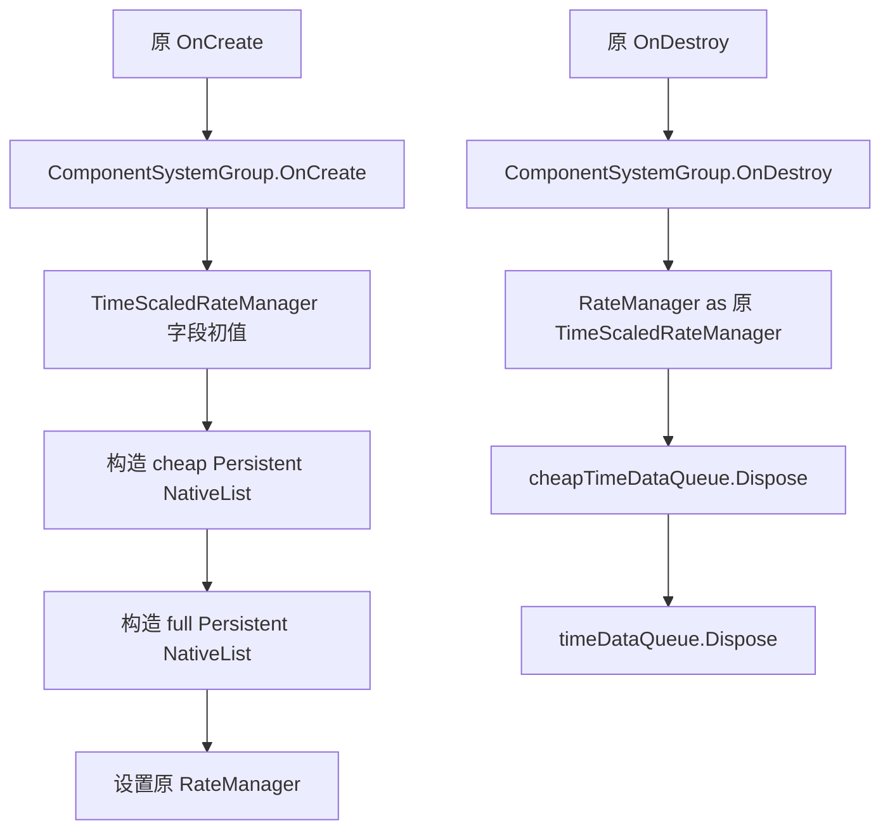

# 34 ECS 系统组原生创建恢复

更新日期：2026-10-19。状态：**AIMovementSystemGroup.cs 单文件的 4 个原生命周期方法和 2 个原字段初始化器已写回；独立源码编译、原 ARM64 调用对照、容器释放控制流及 IL 读回通过。**本阶段没有启动 Unity，主流程可以在该稳定点继续原 MineGameMain 场景观察。OnUpdate 和 ShouldGroupUpdate 仍未恢复，不能据此声称原寻路或核心战斗已经运行。

## 1. 实际故障与单文件边界

主流程第一次运行原场景 `Assets/gameres/bundleres/Scene/MineGameMain.unity`，真实观察记录为 `work/recovery-ledger/unity-play-main1.json`。Entities 的 DefaultWorldInitialization 在把子系统添加到 AIMovementSystemGroup 时抛出：

> Group of type Pathfinding.ECS.AIMovementSystemGroup has not been created, either the derived class forgot to call base.OnCreate(), or it has been destroyed

完整调用链为 AutomaticWorldBootstrap → DefaultWorldInitialization → AddSystemToRootLevelSystemGroupsInternal → ComponentSystemGroup.AddSystemToUpdateList → CheckCreated。当前导出源码的 OnCreate 为空，未执行真实基类 OnCreate；本地正式 Entities 1.3.15 源码由该基类创建系统容器并设置 Created。原 APK native 同样明确调用基类，所以本批恢复生命周期生产者。

唯一修改文件：`Assets/Scripts/AstarPathfindingProject/Pathfinding/ECS/AIMovementSystemGroup.cs`。原 Token / RVA / FieldOffset / Preserve / UpdateAfter 均保留，`.meta` 未改；没有禁用 Entities、删除系统组属性、跳过 bootstrap、手写 Created 或改成替代寻路。

GameManager 第 29 阶段仍保持候选，未随本批接回。

## 2. 原生证据与恢复内容

四项 metadata 边界与 IDA 实际函数起止全部一致，无 unresolved JUMPOUT。另从原 ELF 提取全部相关 ARM64，独立解析 MethodInfo、类型 metadata 引用和基类 RateManager 访问。

| 方法 | 原 Token | 原地址 / 结束边界 | 恢复的实际行为 |
|---|---|---|---|
| AIMovementSystemGroup.OnCreate | `0x06001547` | `0x44CD6AC–0x44CD70C` | 先 base.OnCreate，再构造原 TimeScaledRateManager，写入原 RateManager |
| TimeScaledRateManager 构造 | `0x0600154E` | `0x44CD70C–0x44CD7C4` | 原字段初值、先 cheap 队列后 full 队列，两个 NativeList<TimeData>(Allocator.Persistent) |
| AIMovementSystemGroup.OnDestroy | `0x06001546` | `0x44CD5D4–0x44CD658` | 先 base.OnDestroy，再按原类型检查取得 RateManager 并调用 Dispose |
| TimeScaledRateManager.Dispose | `0x0600154F` | `0x44CD658–0x44CD6AC` | 先释放 cheapTimeDataQueue，再释放 timeDataQueue，无自行增加的条件或清理分支 |

构造在 System.Object 构造调用前写入最大步长和时间倍率，因此源码使用字段初始化器：

```csharp
private float maximumDt = 1f / 30f;
public double CustomTimeScale = 1d;
```

原最大步长 float32 位为十进制 `1023969417`，十六进制 `0x3D088889`，即编译 IL 中 `0.033333335`；原 double 时间倍率位为 `0x3FF0000000000000`。其他索引、时间和静态字段保持 CLR 原零初始化，没有按后继算法需求猜测初值。

原 ARM64 在 OnCreate 的 `0x44CD6FC` 写入 self+`0x88`。该地址已通过原 Cpp2IL metadata 复核为基类 `Unity.Entities.ComponentSystemGroup.m_RateManager`，类型 `Unity.Entities.IRateManager`，Token `0x04000071`，Offset 136。原 getter `0x7E47174`、setter `0x7E4717C` 也只有同一 offset 的 LDR / STR；本地正式包的 RateManager 属性同样直接访问该字段。因此源码使用原公开属性，不访问偏移内存，也不改成 SetRateManagerCreateAllocator 引入额外分配。

## 3. 创建与释放顺序、异常边界



原 OnDestroy 在基类销毁之后才取 manager。null 或不同类型都进入原 null-reference 路径，所以使用 `(RateManager as TimeScaledRateManager).Dispose()`，不改成强制类型转换产生不同异常，也不增加条件跳过。manager 引用在原 native 没有清空，源码也不清空。

两个列表字段分别为原 `+0x28`、`+0x30`，构造时各自分配，Allocator.Persistent 的原值为 4。Dispose 本身没有 IsCreated 判断、try/finally 或补偿分支；实际 NativeList 的底层安全检查和释放由正式 Collections 包执行。本批不扩大到替包修复。

原异常路径也保持：基类创建失败就不分配 manager；第二个列表构造失败时没有原 native 不存在的回滚；基类销毁失败就不调用 manager.Dispose；第一个列表 Dispose 失败时不会继续第二个列表。这些边界按原行为恢复，未设计新的容错策略。

## 4. 原 ARM64 直接执行对照

`emulate_lifecycle.py` 从原 ELF 按四个精确边界加载指令，使用 Unicorn 执行原 OnCreate → 原构造 → 原 OnDestroy → 原 Dispose；metadata 槽按原 ELF relocation 解析。只对外部 Unity 基类和分配/释放 API 设置可记录 hooks，没有把四个待恢复方法改写成 Python 逻辑。

正常链实测输出：base-create → new-manager → 在 Object 构造前观察到原 dt 位与 CustomScale → 两次 allocator=4 的列表构造 → 原 manager 写入 group+0x88 → base-destroy → 释放 manager+0x28 → 释放 manager+0x30。两个释放指针与原两个创建指针逐项相等。另执行 manager 为 null、manager 类型不匹配两条原 OnDestroy 路径，均先调用基类，再进入原 null-reference helper。

共 **3 个原生执行案例**通过，四段原代码哈希和调用轨迹见 `native-lifecycle-oracle.json`。它证明原四方法调用和字段行为；外部 NativeList 分配由 hooks 模型化，不能代替 Unity 中实际 native allocator 或安全句柄验收。

## 5. 实际源码验证

| 验证 | 结果 | 证明范围 |
|---|---|---|
| 实际单文件 netstandard2.1 / C#9 独立编译，引用正式导入的 Unity / Entities / Collections / Transforms | **0 错误、13 警告** | 原 API、NativeList 构造、IRateManager 和基类生命周期签名可以真实编译 |
| 原始空壳负对照 | **8 场景全部失败，2 检查完成** | 能发现缺少基类创建、分配和释放，非只验证无操作代码 |
| 从实际生产源直接编译的依赖适配夹具 | **8 场景、36 检查、0 失败** | ECS 注册前置、两列表所有权、创建/释放顺序、原 dt 位、异常中断和原类型检查 |
| 原 ARM64 生命周期执行 | **3 案例通过** | 四个原方法实际指令和调用参数、两个原字段 offset、正常和 null/type 分支 |
| 原 metadata / IDA | **4 边界匹配** | 方法身份和正文完整边界 |
| 实际编译 IL 读回 | **10 项通过** | 先 base 再 new / set；先 base destroy 再 isinst / Dispose；初值在 Object 构造前；两个 Persistent 列表；cheap→full；未加分支 |
| 狭窄源码读回 | **通过** | 去掉本批四正文和两初始化器后与原文件完全相同，原 Token 顺序与 meta 哈希保持 |
| 本阶段 Unity 导入 / Play / 寻路 / 原核心玩法 | **not-run** | 主流程负责后继统一 Unity 观察，独立结果不冒充运行验收 |

13 个独立编译警告包括正式 Entities 引用对 System.Net.Http 的版本统一提示，以及仍未恢复算法使用的原保留字段未使用提示。没有为消除警告删除字段或补造算法。

适配夹具直接 Compile Include 实际生产源，未维护另一份测试用 AIMovementSystemGroup。Unity 生命周期和容器 API 使用保留关键行为的 adapters，以便控制失败顺序和检查所有权；不验证 World、系统调度、真实 native 内存或 Unity player loop。正常创建销毁后的模型容器计数为零，不据此声称实际 Unity 无泄漏。

## 6. 未恢复范围和后继限制

以下仍为原导出空壳，本批不计作恢复：OnUpdate、TimeScaledRateManager.ShouldGroupUpdate、OnSimulationStepsFinished、外层 CustomTimeScale getter/setter、CheapSimulationOnly / CheapStepDeltaTime / IsLastSubstep / IsFirstSubstep / NumUpdatesThisFrame，以及 Timestep getter/setter。原 AIMovementSystemGroup 构造在 C# 中隐式调用基类，与原单跳转构造一致，未重复计数。

因此当前生命周期可以创建并拥有原两个队列，但调度和时间细分算法尚不工作，OnUpdate 不会运行实际子系统更新。首次 Play 的“未创建”异常需要主流程重新运行确认是否消失；即使该异常消失，也不等于寻路、地图生成、单位移动、开格或战斗恢复。本批没有处理同次观察中的 Spine atlas 或材质错误，保持主流程并行恢复边界。

## 7. 哈希、复现与归档

- 原文件 SHA-256：`81c66c76b58769bdfc8153a2b50cdb1c211d98bac48a21558a5b266466087277`。
- 实际恢复源 SHA-256：`66ae8f28271960b6bcff0cd27698c822b123d29857f880d34c4112382877ea1b`。
- 原及当前 `.meta` SHA-256：`316ad4c103907cbcfb16cf1cbb921bc90584b402b82779aae5de7a1ec33452af`。

```powershell
dotnet build work/ecs-group-recovery/compile/ECSGroupCompile.csproj -c Release
dotnet run --project work/ecs-group-recovery/tests/ECSGroupTests.csproj -c Release
& 'C:/Users/luxinyu/AppData/Local/Programs/idapromcp/source/.venv/Scripts/python.exe' work/ecs-group-recovery/emulate_lifecycle.py
& 'C:/Users/luxinyu/AppData/Local/Programs/idapromcp/source/.venv/Scripts/python.exe' work/ecs-group-recovery/audit.py
```

负对照以 `-p:Baseline=true` 直接编译只读 source-before 副本。独立实验 DLL 只在 work，未拷入 Unity。源码前后态、meta、窄 diff、四方法 IDA/ASM、全部相关原 ARM64、基类 metadata offset、原生执行轨迹、适配测试与日志、实际编译 IL 和 final-audit.json 归档至 `证据/ECS系统组创建/`；不包含大型 IDA 数据库和实验二进制。
