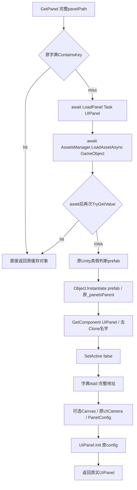

# 48 新游戏 UI 入口最小恢复路线

更新日期：2026-10-19。状态：**本阶段仅完成只读取证、work 候选和最小实施计划，生产源码 0 修改、Unity 操作 0 次。**已定位新游戏 `UIFramework.UIManager`，并完成 Init / GetPanel / LoadPanel 三方法的独立候选编译，0 错误、9 警告；尚未应用或运行该候选，不宣称新 UI 已初始化、面板已显示或原玩法通过。

## 1. 真正的 UIManager 与旧 GF UIModule 边界

确切拟拥有文件为 `Assets/Scripts/Assembly-CSharp/UIFramework/UIManager.cs`，类型 Token `0x02000C53`，继承已经恢复的 ToolModule.ManagerBase<UIManager>。这条新游戏链与第 40 阶段的 `GFRunning/GameFramework/UIModule.cs` 不同。

| 对象 | 旧 GF UIModule（第40阶段） | 新 UIManager（本阶段） |
|---|---|---|
| 实际类型 | GameFramework.UIModule | UIFramework.UIManager |
| 启动根 | 原 GFUICanvas + 加载 UI/UIRoot prefab | 原代码直接 new GameObject("UIPanelsRoot").transform |
| 面板资源 | 原 ResourcesModule / NewResLoadHelper | AssetsManager.LoadAssetAsync<GameObject> → 正式 Addressables |
| 完成语义 | 实际 UIRoot 布局后写自身 ready / 回调 | Init 创建字典和根后写自身 initcomplete；单个Panel另有真实加载链 |

不能把旧 UI/UIRoot prefab、GFUICanvas 或第 39 阶段 LocalEditorResourcesProvider 直接接到新 UIManager 来“完成 UI”。本阶段没有修改旧框架、41配置、42 FSM、43 Hex、44 Battle、39资源源或用户当前 GUI Unity。

## 2. 上游真实调用和最小方法身份

第 15 阶段已恢复的 GameLauncher.InitManager 原顺序为：启动 Time / LoadConfig 早期任务 → await IAP.Init → await DataManager.Init → **await UIManager.Init** → await 先前的 LoadConfig → await LoadData / 真实 LoadDataCompleted → UserResources → CameraManager.Init → 等待资源预载与时间任务 → CustomBundles.Init → **await UIManager.GetPanel(NoInternetPanel完整地址)**。

因此 UIManager.Init 和首个 GetPanel 之间原本已有配置、数据和相机等待；不能把它们移动、删掉或把 UIManager.Init 变成“统一加载所有UI”。

| 最小候选方法 | 原 Token | 原入口 RVA | 原状态机正文 | 实际 await 数 |
|---|---|---|---|---:|
| UIManager.Init | `0x06004C57` | `0x4275C18` | `0x4276F18`，652 B | 0 |
| UIManager.GetPanel | `0x06004C58` | `0x4275C9C` | `0x42767AC`，852 B | 1：Task<UIPanel> |
| UIManager.LoadPanel | `0x06004C5C` | `0x4275FEC` | `0x42771B0`，2,044 B | 1：UniTask<GameObject> |

Init 原本是 async UniTask，但没有 await。它依次创建 Dictionary<string,UIPanel>、创建原名 `UIPanelsRoot` 的 GameObject 并保存 transform，然后才写自身 initcomplete=true。保留 async builder 的异常语义，不改成“return CompletedTask”的同步简化。原 Init 没有 already-complete guard，重复调用会重置字典并创建另一个根；本阶段不为其设计新的幂等行为。

UIManager 构造 `0x06004C62 / 0x42766FC` 只调用原 ManagerBase 构造，现有隐式基类构造已等价，**不把字典初始化提前放入构造器**。原 Init 没有加载 UIRoot prefab、给根添加 Canvas、调用 InitToCanvas 或 DontDestroyOnLoad。

本次按完整原 ELF 提取 38 个相关方法、11,772 B，含 UIManager、必要 UIPanel 叶子与显示边界；在本代理独立 launcher.i64 取 21 个有界伪 C/ASM，实际函数起止均与 metadata 一致。38 或 21 是取证范围，不是本批拟修改方法数。泛型/async工厂以原声明和状态机正文共同判断，不以伪 C 的返回结构体简写推断业务。

## 3. 必须保持的 cache / await / Instantiate 顺序

GetPanel 的缓存 key 是完整 panelPath；命中时直接返回缓存引用，没有额外的 Unity 销毁对象自修复。冷路径 await 私有 Task<UIPanel>，原代码没有独立的 in-flight task 字典。LoadPanel 在 typed 资源等待结束后再次查缓存，这才防止并发冷请求重复 Instantiate；不能删除第二次查询，也不能据此新建一个原来没有的 UI任务缓存。

真实 typed 加载已由已恢复 AssetsManager 完成：校验原 AddressablesConfig 目录项、处理原 handle/cache/refcount、调用正式 Addressables.LoadAssetAsync<T> 并 await 实际结果。此实现必须复用，不能以哈希或“地址存在”替代加载，也不能改成从旧 provider 直接拿一个假 GameObject。

原对象创建是 **LoadAssetAsync<GameObject> 后的 Object.Instantiate(prefab, _panelsParent)**，不是 Addressables.InstantiateAsync。克隆上必须存在实际 UIPanel 子类；原 prefab 名去掉 `(Clone)` 后，先 SetActive(false)，再 `_uiPanelsDict.Add(panelPath,panel)`。随后才配置 Canvas、相机和 PanelConfig。

这个原顺序意味着 Canvas/相机/配置后续步骤失败时，缓存可能已经插入一个未完成装配的对象；本阶段不会加入回滚或把缓存写入后移。typed 加载失败、Prefab不满足原Unity真假条件、缺少实际UIPanel组件、配置查找失败的行为各自保留，不把它们统一改成“成功返回占位Panel”。

## 4. Canvas、配置与必要叶子扩展

LoadPanel 只在实际克隆的 panel.transform 上 TryGetComponent<Canvas> 成功时继续：renderMode=ScreenSpaceCamera → worldCamera=CameraModule.CameraManager.Instance.UICamera → 在真实 DataManager.GlobalInfo.panelConfigs 中 Find → 有配置时设 sortingOrder=config.layer，缺配置则输出原错误 → 调用 panel.Init(config)。没有 Canvas 时原逻辑不进入这一段。

原 predicate `0x427674C` 精确比较 `PanelConfig.panelName == 实例panel.name`，区分大小写，不按路径、ID或小写别名找。原 ShowPanel 的 predicate `0x4276788` 则比较 panelName 与 Path.GetFileNameWithoutExtension(panelPath)，这是显示入口的另一条原路径，不能混成一份猜测的命名逻辑。

最小三方法候选还需要 **一个明确的叶子范围扩展**：

`Assets/Scripts/Assembly-CSharp/UIFramework/UIPanel.cs` 的 `Init(PanelConfig)`，Token `0x06004C4C`，RVA `0x4275658`，原正文只有 `panel+0x38 = config` 的 8 B 字段存储。当前源仍为空。本候选保留调用它，但未擅自修改该文件，也不能通过反射或新增公共字段绕过原私有契约。若主流程批准最小实施，建议仅同时补这一个叶子方法，其他 UIPanel 内容另批。

## 5. 首个资源面板不等于首个显示画面

GameLauncher.InitManager 首个明确的 Addressable 面板请求为：

`Assets/_Res/Addressable/01FirstBundle/Prefabs/UI/Panels/NoInternetPanel.prefab`。

当前正式 AddressablesConfig 中该地址唯一归属 FirstPack；实际 prefab 名为 NoInternetPanel，带 Canvas、CanvasScaler、GraphicRaycaster 和对应 NoInternetPanel 脚本。脚本 GUID `e7aed5a18c37e437835d9bb882ac77bc` 与当前 `UIModuleO/NoInternetPanel.cs.meta` 一致，后者通过 NoInternetPanelComponents 继承 UIPanel。

当前 PanelConfig 原载荷解码出的匹配行是：id=10003、panelName=NoInternetPanel、group=4、layer=100、openEffect=0、blockTutorialTrigger=false。当前 prefab 原序列化 sortingOrder=1000，原 LoadPanel 会按真实 config.layer 改成 100，不能把静态 prefab 值当成最终运行层级。原配置/资源字节 SHA 和匹配记录在 `first-panel-static-identity.json`；本阶段只读载荷，不写配置或资源。

这里调用的是 GetPanel **预取**，原克隆随后隐藏并缓存，不应为了演示强行 Show。LoadingManager.StartLoading 更早会从已存在的名为 LoadingPanel 的对象获取 UIPanel 并调用 Show；它不经过这一项 Addressable GetPanel。因此本阶段不能称 NoInternetPanel 为“原第一幅必须显示的画面”。

UIManager.ShowPanel 原本先处理 PanelConfig 的教程阻塞分支，再 await GetPanel，最后 await 面板自己的虚 Show；当前 NoInternetPanel.Show override 和 UIPanel.Show 都仍为空，UIManager 显示包装也未纳入三方法最小候选。预取真实完成只可验收 typed load / 真克隆 / 隐藏 / 缓存，不可称视觉和交互已经完成。

## 6. 现有非空正文与明确保护

- UIManager.IsPanelShowing，Token `0x06004C59 / 0x4275D78`，当前有明确 `RECOVERY_UNIMPLEMENTED` 异常诊断；三方法候选逐字保留，不把它悄悄改成 false。
- UIPanel.IsPlayTween，Token `0x06004C40 / 0x4275278`，已有恢复的字段 getter，保持原样。本阶段没有将 UIPanel 文件整体覆盖。
- 已恢复的 ManagerBase.Instance、GameLauncher.InitManager 和 AssetsManager typed Addressables 链均保持；候选不替换为新单例、资源适配器或“已完成”字段。
- 41 配置、42 FSM、43 Hex、44 Battle、39 资源文件只读取依赖，不改变其所有权、数据和生成结果。

UIManager 当前源 SHA-256 为 `bed0b6d3bbbc19f750a0788ea6a03d04c9cb74e768aa02ad69459b77cd125ef7`，本阶段结束仍与只读前态逐字节相同；meta 保持。各只读依赖的当前哈希在机器计划中保存，不依赖外部窗口的口头完成状态来判断本文件是否可覆盖。

## 7. 缺失依赖与最小实施顺序

建议 **48A**：在范围获准后只写 UIManager 的 Init / GetPanel / LoadPanel，外加上述 UIPanel.Init 一个必要原字段存储。首个可执行目标是原 Init 建立真实根/缓存，随后原 GetPanel 对 NoInternetPanel 完成正式 typed Addressables 加载、实际 UIPanel 克隆、原隐藏/缓存和真实 PanelConfig 绑定。缺失资源或组件按原异常/日志/返回语义呈现，不提前写全局 ready、不返回假 Panel。

相机还需单独处理：CameraManager.UICamera getter，Token `0x060020A7 / 0x3F0E8CC`，当前明确 return null；CameraManager.Init 也仍是空任务。即使本次克隆和缓存能完成，真实相机绑定尚未恢复，不应宣称原 Canvas 绑定或视觉验收通过。该文件不在本次只读候选 owned scope。

建议 **48B**：沿原 UIManager.ShowPanel / HidePanel → UIPanel.Show / Hide / IsShowing / Canvas / TweenRoot → 原具体 Panel override / 组件绑定补足实际显示、动画完成和教程阻塞契约。NoInternetPanel.Show 为 `0x06003E88 / 0x416F664`，状态机 `0x416FEE0`；不能直接绕过 override 调基类显示，也不能为看见面板改网络状态。

以上 UI 分段仍依赖真实配置/数据/资源和上游 IAP/预载/时间等门。一个可编译的 UI 候选并不代表 GameLauncher 已实际执行至这里；本阶段没有启动游戏、设置Data或其它完成字段，也没有结束、保存或切换用户的 dirty 场景。

## 8. work 候选、验证计划与交接

候选在 `work/stage48-new-ui/UIManager.candidate.cs`，仅改变上述三个直接方法并移除它们旧 async 壳的编译器关联标注，原导出壳和 Token 仍保留。候选 SHA-256 为 `845f55cd139cbdb070ecdbee1f01a386e131266b286e2e27eee76fdd00b3310a`。

候选用正式导入的实际 Unity / Unity UI / UniTask / Main / GF 程序集作元数据引用，独立 netstandard2.1/C#9 编译 **0错误、9警告**，警告为单文件同名影子、原 async 无 await 和保留字段等；没有把实验 DLL 安装到 Unity。本阶段夹具、实际源码编译、typed Unity load、实例化、视觉和手工验收均为 **not-run**。

实施后建议按以下真实风险验证，而不是只检查完成标志：

1. await 挂起时不 Instantiate、不插缓存；typed 加载失败保持原错误路径。
2. 并发冷请求在 await 后只创建一个实例，后请求返回原已缓存对象；不增加一套 in-flight 缓存。
3. 缓存命中保留原引用语义；缺 UIPanel、缺 Canvas、缺 PanelConfig 的不同结果和错误副作用顺序保持。
4. SetActive(false) → cache.Add → Canvas/相机/配置/Init 的原次序与故障后缓存状态保持。
5. 由主流程在已有正式配置和资源下实际 typed load、实例化并记录地址、类型、原/克隆identity、parent、activeSelf、Canvas相机、sortingOrder及cache命中；不强制Show或设置完成标志。

机器计划 `work/stage48-new-ui/minimal-recovery-plan.json` 和并行交接 `work/parallel-coordination/stage48-ui-plan-handoff.json` 包含 owned 文件、三方法精确身份、21项native targets、源前态保护和外部依赖。报告、候选、原ASM/伪C、取证状态、资源静态身份、编译日志和哈希清单归档至 `证据/新游戏UI入口计划/`；生产源仍未改。
